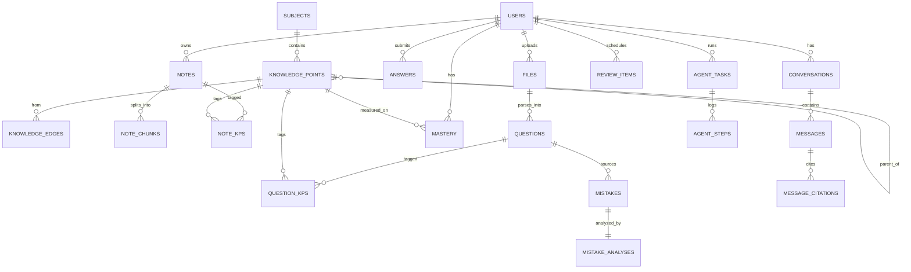

# SCHEMA.md — 数据模型契约

> 来源：《个性化学习智能体-毕业设计完整方案.md》第 5 章。本文件是建表与 Alembic 迁移的**唯一依据**，与代码冲突时以本文件为准（AGENTS.md §8）。
>
> 整理规则（S0-3 任务卡约定）：
> - 字段**全部来自方案原文**，未增删改名；
> - 方案未明示的类型/可空性/默认值按 PostgreSQL 16 惯例补齐，统一以 ⚠ 标注，**S2-1 建迁移前必须复核**；
> - 不写 SQL，只写 Markdown 表格；
> - 标记图例：✅ 方案原文明确 ｜ ⚠ 按惯例推断待复核 ｜ TODO 待后续任务定稿。

## 0. 全局约定

- 命名：表名与字段名一律 `snake_case`（与 API 命名一致，**定死**）
- 主键：统一 `id BIGINT GENERATED ALWAYS AS IDENTITY`（⚠惯例）
- 外键：`BIGINT`，命名 `<表名单数>_id`
- 时间：统一 `TIMESTAMPTZ`；`created_at` 默认 `now()`
- 软删除：`deleted_at`，检索时统一过滤（方案 5.3）
- 数组字段（方案中 `xxx[]` 写法）：`TEXT[]` / `BIGINT[]`（✅ S2-1 定稿：用原生数组，标签检索建 GIN，不转 JSONB）
- 向量维度：统一 `VECTOR(1024)`（✅ S1-3 定稿：DashScope text-embedding-v4 实测输出 1024）
- JSON 字段：统一 `JSONB`
- 金额/权重/分数：`NUMERIC`

## 1. ER 总览（方案 5.1）



## 2. 用户与权限

### 2.1 users

| 字段 | 类型 | 可空 | 默认值 | 说明 | 索引 |
|---|---|---|---|---|---|
| id | BIGINT | 否 | 自增 | 主键 | PK ⚠ |
| username | TEXT | 否 | — | 登录名 | UNIQUE ⚠ |
| password_hash | TEXT | 否 | — | 口令哈希（fastapi-users 管理） | — |
| nickname | TEXT | 否 | — | 显示昵称 | — |
| grade | TEXT | 是 | — | 年级（取值待定 TODO） | — |
| role | TEXT | 否 | 'student' ⚠ | 枚举见 §10.1 | — |
| created_at | TIMESTAMPTZ | 否 | now() | 创建时间 | — |
| updated_at | TIMESTAMPTZ | 否 | now() | 应用层 onupdate 维护（S2-1 补） | — |

### 2.2 user_relations

家长/老师绑定学生，用于查看报告（方案原文）。字段名沿用方案 `teacher_id`（语义为"查看方"，家长复用此字段）。

| 字段 | 类型 | 可空 | 默认值 | 说明 | 索引 |
|---|---|---|---|---|---|
| id | BIGINT | 否 | 自增 | 主键 | PK ⚠ |
| teacher_id | BIGINT | 否 | — | 老师/家长，FK→users | 复合 UNIQUE(teacher_id, student_id) ⚠ |
| student_id | BIGINT | 否 | — | 被绑定学生，FK→users | idx(student_id) ✅（S2-1 补） |
| created_at | TIMESTAMPTZ | 否 | now() | 创建时间（S2-1 补） | — |
| updated_at | TIMESTAMPTZ | 否 | now() | 应用层 onupdate 维护（S2-1 补） | — |

> S2-1 落库时新增 `ck_user_relations_not_self`：禁止 teacher_id = student_id。

### 2.3 subjects

| 字段 | 类型 | 可空 | 默认值 | 说明 | 索引 |
|---|---|---|---|---|---|
| id | BIGINT | 否 | 自增 | 主键 | PK ⚠ |
| name | TEXT | 否 | — | 学科名，如"数学" | — |
| code | TEXT | 否 | — | 学科代码，如 math | UNIQUE ⚠ |
| stage | TEXT | 否 | '高中' ⚠ | 学段 | — |
| config_json | JSONB | 是 | — | 难度分布/题型配比默认值 | — |
| created_at | TIMESTAMPTZ | 否 | now() | 创建时间（S2-1 补） | — |
| updated_at | TIMESTAMPTZ | 否 | now() | 应用层 onupdate 维护（S2-1 补） | — |

## 3. 知识组织

### 3.1 knowledge_points

| 字段 | 类型 | 可空 | 默认值 | 说明 | 索引 |
|---|---|---|---|---|---|
| id | BIGINT | 否 | 自增 | 主键 | PK ⚠ |
| subject_id | BIGINT | 否 | — | FK→subjects | idx ⚠ |
| parent_id | BIGINT | 是 | — | 上级知识点（根为 NULL），自引用 | idx ⚠ |
| name | TEXT | 否 | — | 知识点名称 | — |
| code | TEXT | 否 | — | 如 MATH-FUNC-012 | UNIQUE(subject_id, code) ⚠ |
| level | SMALLINT | 否 | — | 层级 1–4 ✅；`CHECK 1..4` ✅（S2-1） | — |
| description | TEXT | 是 | — | 说明 | — |
| exam_weight | NUMERIC | 是 | — | 考纲权重（复习优先级、组卷打分用） | — |
| embedding | VECTOR(1024) | 是 | — | 语义向量（对齐打分用，方案 6.2） | HNSW ✅（S2-1 建） |
| order_no | INTEGER | 否 | 0 ⚠ | 同层排序 | — |
| created_at | TIMESTAMPTZ | 否 | now() | 创建时间（S2-1 补） | — |
| updated_at | TIMESTAMPTZ | 否 | now() | 应用层 onupdate 维护（S2-1 补） | — |

> S2-1：`embedding` 列与 HNSW 索引已建，数据由 S2-10 写入；`parent_id` 自引用不设级联删除（NO ACTION），删除顺序由 S2-9 业务控制。
>
> S2-9：种子树由 `scripts/import_kp_tree.py` 写入（`subjects.math` 首次自动创建）；`level` 由父节点推导（根 1、最深 4），不接受客户端直传；`code` 创建后稳定不可改，导入按 `(subject_id, code)` 对齐；删除保护为业务层（子节点 → `note_kps` → `knowledge_edges` 依次检查，不级联）。

### 3.2 knowledge_edges

| 字段 | 类型 | 可空 | 默认值 | 说明 | 索引 |
|---|---|---|---|---|---|
| id | BIGINT | 否 | 自增 | 主键 | PK ⚠ |
| src_kp_id | BIGINT | 否 | — | 起点知识点 | 复合 UNIQUE(src_kp_id, dst_kp_id, relation) ⚠ |
| dst_kp_id | BIGINT | 否 | — | 终点知识点 | idx ⚠ |
| relation | TEXT | 否 | — | 枚举见 §10.3 | — |
| weight | NUMERIC | 是 | — | 关系强度 | — |
| source | TEXT | 否 | — | ai / manual（§10.4） | — |
| created_at | TIMESTAMPTZ | 否 | now() | 创建时间（S2-1 补） | — |
| updated_at | TIMESTAMPTZ | 否 | now() | 应用层 onupdate 维护（S2-1 补） | — |
| review_status | TEXT | 否 | 'pending' | 审核状态，§10.17（S4-5） | idx |
| reviewed_by | BIGINT | 是 | — | 审核人 users.id，FK ON DELETE SET NULL（S4-5） | — |
| reviewed_at | TIMESTAMPTZ | 是 | — | 最近一次审核时间（S4-5） | — |

> S2-1 新增 `ck_knowledge_edges_not_self`（src_kp_id <> dst_kp_id）；relation / source 以 CHECK 约束落库。

> S4-5 新增 `ck_knowledge_edges_review_status`（待校验/通过/驳回）与 `ck_knowledge_edges_reviewed`（`pending` 时 `reviewed_at` 必须为空，非 `pending` 时非空；`reviewed_by` 允许空以支持脚本批量通过）。迁移 `0012_s4_5` 把历史行回填为 `approved`；`contains` 派生边一律直接 `approved`；`rejected` 行作为墓碑保留，重跑不会复活。
> S4-6 读取口径：图谱接口只读、不加列。`GET /kp/graph/snapshot` 只返回 `review_status='approved'` 的边（`pending` 仅以 `stats.pending_edges` 计数暴露给老师），节点配色暂用「当前用户错题数」作热力（**不是**掌握度，S4-7 换真实掌握度，见 D-049）。

## 4. 笔记与文件

> S2-5 迁移 `0003_s2_5` 已建表：files / notes / note_kps，并为 note_chunks 补 3 个外键（见 §4.3）。

### 4.1 files

| 字段 | 类型 | 可空 | 默认值 | 说明 | 索引 |
|---|---|---|---|---|---|
| id | BIGINT | 否 | 自增 | 主键 | PK ⚠ |
| user_id | BIGINT | 否 | — | 上传者 | idx ⚠ |
| filename | TEXT | 否 | — | 原始文件名 | — |
| mime | TEXT | 否 | — | MIME 类型 | — |
| size | BIGINT | 否 | — | 字节数 | — |
| storage_path | TEXT | 否 | — | MinIO 对象键：`uploads/{user_id}/{sha256[:2]}/{sha256}{ext}` ✅（S2-6 定稿；不返回给客户端） | — |
| sha256 | TEXT | 否 | — | 内容哈希（去重，方案 5.3） | UNIQUE(user_id, sha256) ✅（S2-5 定稿：同用户唯一，跨用户互不可见） |
| parse_status | TEXT | 否 | 'pending' | 解析状态，§10.2（S2-8 定稿四值） | idx ⚠ |
| parse_progress | SMALLINT | 否 | 0 | 解析进度阶段值 0/10/50/80/100，CHECK 0–100（S2-8） | — |
| error_msg | TEXT | 是 | — | 最近一次解析失败原因，≤500 字（S2-8） | — |
| parse_started_at | TIMESTAMPTZ | 是 | — | 首次开始解析时间（S2-8） | — |
| parse_finished_at | TIMESTAMPTZ | 是 | — | 终态时间（S2-8） | — |
| parse_result_json | JSONB | 是 | — | 解析统计：parser/pages/blocks/chunks/tokens/elapsed_ms/degraded_reason/note_id；**不含正文**（S2-8） | — |
| created_at | TIMESTAMPTZ | 否 | now() | 创建时间 | — |

### 4.2 notes

| 字段 | 类型 | 可空 | 默认值 | 说明 | 索引 |
|---|---|---|---|---|---|
| id | BIGINT | 否 | 自增 | 主键 | PK ⚠ |
| user_id | BIGINT | 否 | — | 所有者（检索必须过滤） | idx(user_id, subject_id) ⚠ |
| subject_id | BIGINT | 是 | — | 所属学科 | — |
| title | TEXT | 否 | — | 标题 | — |
| content_md | TEXT | 否 | — | Markdown 正文（公式为 LaTeX） | — |
| content_text | TEXT | 否 | — | 去公式纯文本，供全文检索 ✅ | — |
| tags | TEXT[] ⚠ | 是 | — | 标签 | GIN ⚠建议 |
| folder | TEXT | 是 | — | 所属笔记本/文件夹 | — |
| source_file_id | BIGINT | 是 | — | 来源文件，FK→files | — |
| created_at | TIMESTAMPTZ | 否 | now() | | — |
| updated_at | TIMESTAMPTZ | 否 | now() | 应用层维护 ⚠ | — |
| deleted_at | TIMESTAMPTZ | 是 | — | 软删除（检索时统一过滤） | — |

### 4.3 note_chunks

| 字段 | 类型 | 可空 | 默认值 | 说明 | 索引 |
|---|---|---|---|---|---|
| id | BIGINT | 否 | 自增 | 主键 | PK ⚠ |
| note_id | BIGINT | 否 | — | 所属笔记 | 复合 UNIQUE(note_id, chunk_index) ⚠ |
| user_id | BIGINT | 否 | — | 冗余存储，过滤下推（方案 5.3） | idx ⚠ |
| chunk_index | INTEGER | 否 | — | 块序号 | — |
| content | TEXT | 否 | — | 块文本 | — |
| token_count | INTEGER | 否 | — | token 数（上下文预算用） | — |
| chunk_type | TEXT | 是 | 'note' | question/note/formula（切片器判定，S4 错题诊断按 question 过滤） | — |
| heading_path | TEXT | 是 | — | 如"函数/单调性/例题2"（引用卡片显示） | — |
| embedding | VECTOR(1024) | 否 | — | 语义向量 | HNSW(vector_cosine_ops, m=16, ef_construction=64) ✅ |
| tsv | TSVECTOR | 是 | — | jieba 切词后写入（§9） | GIN ✅ |
| source_file_id | BIGINT | 是 | — | 来源文件 | — |
| page_no | INTEGER | 是 | — | 页码（引用定位） | — |
| bbox_json | JSONB | 是 | — | 原文位置框（引用高亮） | — |

> S2-1 复核时把外键延后到 S2-5；**S2-5 迁移 0003 已补齐**：`note_id → notes.id`（ON DELETE CASCADE）、`user_id → users.id`、`source_file_id → files.id`。补外键前条件清理了无主行（本库 83 行 S1-3 实验残留，`user_id=1` 但 users 为空），删除后不可恢复。
>
> S3-1 起本表同时承载**手写笔记**（按 `notes.content_md` 的 Markdown 重建，`page_no/bbox_json` 为空）与文档笔记（解析产物）；全量重建会把文档笔记的 `page_no/bbox_json` 清空，属已确认代价。软删笔记时同事务删除本表对应行。
>
> S3-2 检索的 scope 过滤通过 `note_chunks JOIN notes` 读取 `subject_id/folder/created_at`，并恒带 `notes.user_id`、`notes.deleted_at IS NULL`；**不在切片冗余这些列、不新增索引/迁移**。`shared_buffers`/HNSW 计划见 §9。

### 4.4 note_kps

| 字段 | 类型 | 可空 | 默认值 | 说明 | 索引 |
|---|---|---|---|---|---|
| note_id | BIGINT | 否 | — | 笔记 | 复合 PK(note_id, kp_id) ⚠ |
| kp_id | BIGINT | 否 | — | 知识点 | idx ⚠ |
| confidence | NUMERIC | 是 | — | 对齐置信度（0.55–0.75 进待确认队列，方案 6.2） | — |
| source | TEXT | 否 | — | ai / manual（§10.4） | — |
| confirmed | BOOLEAN | 否 | false ⚠ | 用户是否确认 | — |

> S2-10 语义：自动关联写 `source='ai', confirmed=true`；0.55–0.75 进待确认队列写 `source='ai', confirmed=false`；用户批量确认后改 `confirmed=true, source='manual'`，忽略直接删除。重跑对齐只替换该笔记 `source='ai'` 的行，`manual` 行保留。表无时间列，待确认队列固定按 `(note_id DESC, kp_id)` 排序。

### 4.5 async_tasks（S2-7）

异步任务状态表：ARQ 只负责投递与延时重试，状态/结果/历史全在这里。

| 字段 | 类型 | 可空 | 默认值 | 说明 | 索引 |
|---|---|---|---|---|---|
| id | BIGINT IDENTITY | 否 | 自增 | 主键；同时作为 ARQ job id（`task:{id}`） | PK |
| user_id | BIGINT | 否 | — | 创建者 → users.id | 复合 idx(user_id, created_at) |
| name | TEXT | 否 | — | 任务名（注册表键，如 `demo.sleep`） | — |
| status | TEXT | 否 | pending | pending / running / succeeded / failed（§10.15） | idx |
| payload | JSONB | 否 | `{}` | 提交参数 | — |
| result | JSONB | 是 | — | 成功结果 | — |
| error | TEXT | 是 | — | 最近一次失败原因（重试中也写） | — |
| attempts | INT | 否 | 0 | 已执行次数（= ARQ job_try） | — |
| created_at | TIMESTAMPTZ | 否 | now() | | 复合 idx |
| started_at | TIMESTAMPTZ | 是 | — | 首次开始执行时间（重试不覆盖） | — |
| finished_at | TIMESTAMPTZ | 是 | — | 终态时间 | — |

## 5. 题库与错题

### 5.1 questions

| 字段 | 类型 | 可空 | 默认值 | 说明 | 索引 |
|---|---|---|---|---|---|
| id | BIGINT | 否 | 自增 | 主键 | PK ⚠ |
| subject_id | BIGINT | 否 | — | 学科 | idx ⚠ |
| origin | TEXT | 否 | — | 来源，§10.5 | idx(origin) ⚠ |
| source_file_id | BIGINT | 是 | — | 试卷切题来源文件 | — |
| stem_md | TEXT | 否 | — | 题干 Markdown | — |
| stem_latex | TEXT | 是 | — | 题干 LaTeX（整题可由单个公式表达时才填，否则 NULL） | — |
| stem_hash | TEXT | 否 | — | 规范化题干的 sha256：去题号/空白/全角标点后计算（S4-1 定稿，判重第一道闸） | UNIQUE(subject_id, stem_hash) ✅ |
| options_json | JSONB | 是 | — | 选项（选择题） | — |
| answer_md | TEXT | 是 | — | 答案 | — |
| analysis_md | TEXT | 是 | — | 解析 | — |
| qtype | TEXT | 否 | — | 题型，§10.6 | idx ⚠ |
| difficulty | SMALLINT | 否 | — | 难度 1–5 ✅ | — |
| tags | TEXT[] ⚠ | 是 | — | 标签 | GIN ⚠建议 |
| verified | BOOLEAN | 否 | false | 答案是否可信（方案 6.5 + S4-1）：AI 生成题须通过复算自检；切题导入时卷面自带答案记 true，答案由 LLM 补写记 false | — |
| embedding | VECTOR(1024) | 是 | — | 语义向量（判重/检索） | HNSW ⚠建议 |
| created_by | BIGINT | 是 | — | 创建人（AI 生成为 NULL ⚠） | — |
| created_at | TIMESTAMPTZ | 否 | now() | 入库时间（S4-1 定稿：题库列表默认按它倒序，需与迁移 0009 一致） | — |

> 判重规则（方案 5.3，S4-1 定稿）：两道闸，命中任一即跳过、不重复入库——① `stem_hash` 命中 `UNIQUE(subject_id, stem_hash)`；② `embedding` 余弦相似度 ≥ 0.92。新人库题目必须同时写入 `stem_hash` 与 `embedding`。

### 5.2 question_kps

| 字段 | 类型 | 可空 | 默认值 | 说明 | 索引 |
|---|---|---|---|---|---|
| question_id | BIGINT | 否 | — | 题目 | 复合 PK(question_id, kp_id) ✅ |
| kp_id | BIGINT | 否 | — | 知识点 | idx(kp_id) ✅（S4-1 定稿，组卷按知识点选题） |
| weight | NUMERIC | 是 | — | 关联权重：S4-1 存对齐打分的原始分（0–1），组卷配额用 | — |

### 5.3 mistakes

> 错题（S4-2 定稿，迁移 `0010_s4_2`）。`UNIQUE(user_id, question_id)` 保证同一学生对同一题只有一条；重复录入是复用重置，不是新增（D-045）。

| 字段 | 类型 | 可空 | 默认值 | 说明 | 索引 |
|---|---|---|---|---|---|
| id | BIGINT | 否 | 自增 | 主键 | PK `mistakes_pkey` ✅ |
| user_id | BIGINT | 否 | — | 所有者 | UNIQUE 组成列；`ix_mistakes_user_status`、`ix_mistakes_user_created`；FK `fk_mistakes_user_id` → `users.id`（NO ACTION） ✅ |
| question_id | BIGINT | 否 | — | 题目 | UNIQUE 组成列；`ix_mistakes_question_id`；FK `fk_mistakes_question_id` → `questions.id` **ON DELETE RESTRICT** ✅ |
| my_answer_md | TEXT | 是 | — | 学生作答；识别不出为 NULL（缺失时不猜错因，方案 6.3） | — |
| correct_answer_md | TEXT | 是 | — | 正确答案（题目带出或识别得到） | — |
| image_file_id | BIGINT | 是 | — | 拍照原图 | FK `fk_mistakes_image_file_id` → `files.id` **ON DELETE SET NULL** ✅ |
| status | TEXT | 否 | `'待订正'` | 状态机，§10.7 | `ck_mistakes_status`；`ix_mistakes_user_status` ✅ |
| correct_streak | INTEGER | 否 | `0` | 连续答对次数；只由复习接口驱动 | `ck_mistakes_correct_streak`（`>= 0`） ✅ |
| created_at | TIMESTAMPTZ | 否 | `now()` | 录入时间；列表默认排序 | `ix_mistakes_user_created` ✅ |
| last_review_at | TIMESTAMPTZ | 是 | — | 最近一次复习时间；录入/改状态都不推进 | — |

**S4-4 写入的 `similar_questions_json` 结构（版本化，`version=1`）**

```json
{
  "version": 1,
  "generated_at": "2026-11-03T15:39:39+00:00",
  "model": "qwen-plus",
  "prompt_version": "question_gen_v1",
  "stats": {"requested": 3, "passed": 3, "rejected": 0, "rounds": 1},
  "items": [
    {
      "variant_id": "abc12345",
      "stem_md": "...", "options": null, "answer_md": "...",
      "analysis_md": "...", "qtype": "解答", "difficulty": 3,
      "kp_ids": [133],
      "self_check": {"status": "passed", "attempts": 1, "verified_answer_md": "..."},
      "accepted_question_id": null, "accepted_at": null
    }
  ],
  "rejected": [{"reason": "数值：3 vs \frac{3}{2}", "stem_excerpt": "计算 $\int_{-1}^{2}...$"}]
}
```

- `variant_id`：8 位十六进制（`secrets.token_hex(4)`），只在「本次生成结果」内唯一，**不是**数据库 id；
  重新生成会整体覆盖，旧 id 立即失效（accept 时 404 提示「已被重新生成」）。
- `items` 只含通过自检的题；`rejected` 记录被丢弃题（最多 9 条，`stem_excerpt` ≤80 字，不落整题面）。
- `accepted_question_id` 由 accept 接口回写；非空即表示已入库（幂等靠它 + `questions.stem_hash` 两道）。
- 结构不认识（`version` 不是 1）时读侧当 `null` 处理，不报错（前端按"尚未生成"展示）。
- 旧库无迁移：列 S4-2 已有，S4-4 只写不建表（`alembic heads` 仍为 `0011_s4_3`）。

**约束与索引（实测 DDL）**

- 主键：`mistakes_pkey`。
- 唯一约束：`uq_mistakes_user_question` = `UNIQUE(user_id, question_id)`（幂等复用与并发冲突都由它兜底）。
- 检查约束：
  - `ck_mistakes_status`：`status IN ('待订正', '已订正', '已掌握')`（`in_check()` 生成，D-021）；
  - `ck_mistakes_correct_streak`：`correct_streak >= 0`。
- 普通索引（均为 btree）：
  - `ix_mistakes_user_status` = `(user_id, status)` → 列表状态筛选与统计；
  - `ix_mistakes_user_created` = `(user_id, created_at)`（**升序**）→ 默认 `created_at DESC` 排序靠反向扫描即可，无需 DESC 索引；
  - `ix_mistakes_question_id` = `(question_id)` → S4-1 `_ensure_not_referenced` 反查。
- 外键（三个 ON DELETE 行为不同，不要混用）：
  - `fk_mistakes_user_id` → `users.id`，**未声明 `ondelete`**，PostgreSQL 默认 **NO ACTION**；删用户不会级联删错题（当前无删用户接口）；
  - `fk_mistakes_question_id` → `questions.id`，**ON DELETE RESTRICT**；与 S4-1 `delete_question` 的引用检查形成双保险（`has_table` 守卫在 S4-2 建表后自动生效）；
  - `fk_mistakes_image_file_id` → `files.id`，**ON DELETE SET NULL**；文件被删时错题保留，只丢原图。

### 5.4 mistake_analyses

> 错题诊断结果（S4-2 只建表，S4-3 写入）。ER 上是 1:1，靠 `UNIQUE(mistake_id)` 保证。

| 字段 | 类型 | 可空 | 默认值 | 说明 | 索引 |
|---|---|---|---|---|---|
| id | BIGINT | 否 | 自增 | 主键 | PK `mistake_analyses_pkey` ✅ |
| mistake_id | BIGINT | 否 | — | 错题（ER 为 1:1） | `uq_mistake_analyses_mistake_id`；FK `fk_mistake_analyses_mistake_id` → `mistakes.id` **ON DELETE CASCADE** ✅ |
| kp_ids | BIGINT[] | 是 | — | 定位到的知识点 | `ix_mistake_analyses_kp_ids` **GIN** ✅ |
| cause_type | TEXT | 否 | — | 主错因，§10.8 | `ck_mistake_analyses_cause_type` ✅ |
| secondary_causes | TEXT[] | 是 | — | 次错因，至多 2 个，元素属于 `CauseType` 值集（S4-3） | `ck_mistake_analyses_secondary_causes` ✅ |
| error_step | TEXT | 是 | — | 第一处出错步骤（引用学生原文） | — |
| explanation_md | TEXT | 是 | — | 正确解法（分步骤 LaTeX） | — |
| similar_questions_json | JSONB | 是 | — | 变式题结果包（S4-4 写入；S4-3 保持 NULL），结构见下 | — |
| review_advice_md | TEXT | 是 | — | 复习建议（前置知识 + 笔记关联） | — |
| confidence | NUMERIC(3,2) | 是 | — | LLM 自评置信度 0.00–1.00（S4-3） | `ck_mistake_analyses_confidence` ✅ |
| model | TEXT | 否 | — | 诊断所用模型 | — |
| prompt_version | TEXT | 否 | — | Prompt 版本（本卡为 `mistake_analyze_v2`，v2 起带错因判定口径） | — |
| created_at | TIMESTAMPTZ | 否 | `now()` | **最近一次诊断**落库时间（重跑覆盖时刷新） | — |

**约束与索引（实测 DDL）**

- 主键：`mistake_analyses_pkey`。
- 唯一约束：`uq_mistake_analyses_mistake_id` = `UNIQUE(mistake_id)`（一道错题至多一条诊断）。
- 检查约束：`ck_mistake_analyses_cause_type`：`cause_type IN ('概念不清', '计算失误', '审题偏差', '方法不当', '知识遗忘', '时间不足', 'unknown')`。
- 检查约束（S4-3，迁移 `0011_s4_3`）：`ck_mistake_analyses_secondary_causes`：`secondary_causes IS NULL OR secondary_causes <@ ARRAY['概念不清','计算失误','审题偏差','方法不当','知识遗忘','时间不足','unknown']::text[]`。
- 检查约束（S4-3，迁移 `0011_s4_3`）：`ck_mistake_analyses_confidence`：`confidence IS NULL OR (confidence >= 0 AND confidence <= 1)`。
- 索引：`ix_mistake_analyses_kp_ids` = **GIN** `(kp_ids)`，支撑列表 `kp_ids @>` 的 `EXISTS` 筛选。
- 外键：`fk_mistake_analyses_mistake_id` → `mistakes.id`，**ON DELETE CASCADE**；删除错题时诊断行由数据库自动清理，`mistake_service.delete_mistake` 仍在同一事务内**显式先删诊断再删错题**（不依赖级联的实现细节）；`test_delete_mistake_removes_analysis_too` 断言诊断删除语句确实执行、删除顺序为「诊断 → 错题」、`commits == 1`。

## 6. 练习与掌握度

### 6.1 papers

| 字段 | 类型 | 可空 | 默认值 | 说明 | 索引 |
|---|---|---|---|---|---|
| id | BIGINT | 否 | 自增 | 主键 | PK ⚠ |
| user_id | BIGINT | 否 | — | 所有者 | idx ⚠ |
| title | TEXT | 否 | — | 试卷标题 | — |
| constraint_json | JSONB | 否 | — | 组卷约束（kp_ids/题型配比/难度分布/总分/时长/排除近期） | — |
| question_ids | BIGINT[] ⚠ | 否 | — | 题目 ID 有序列表 | — |
| total_score | NUMERIC | 否 | — | 总分 | — |
| duration_min | INTEGER | 是 | — | 时长（分钟） | — |
| status | TEXT | 否 | '草稿' | §10.9 | — |
| generated_by | TEXT | 否 | — | manual / ai_agent | — |
| created_at | TIMESTAMPTZ | 否 | now() | | — |

### 6.2 answers

| 字段 | 类型 | 可空 | 默认值 | 说明 | 索引 |
|---|---|---|---|---|---|
| id | BIGINT | 否 | 自增 | 主键 | PK ⚠ |
| user_id | BIGINT | 否 | — | 作答者 | idx(user_id, question_id) ⚠ |
| question_id | BIGINT | 否 | — | 题目 | — |
| paper_id | BIGINT | 是 | — | 所属试卷（非组卷练习为 NULL） | — |
| user_answer_md | TEXT | 是 | — | 作答内容 | — |
| is_correct | BOOLEAN | 是 | — | 判定结果 | — |
| score | NUMERIC | 是 | — | 得分 | — |
| self_rated | NUMERIC | 是 | — | 自评 0 / 0.5 / 1（掌握度更新输入 s，方案 6.6） | — |
| time_spent_sec | INTEGER | 是 | — | 用时（秒） | — |
| created_at | TIMESTAMPTZ | 否 | now() | | — |

### 6.3 mastery

| 字段 | 类型 | 可空 | 默认值 | 说明 | 索引 |
|---|---|---|---|---|---|
| id | BIGINT | 否 | 自增 | 主键 | PK ⚠ |
| user_id | BIGINT | 否 | — | | 复合 UNIQUE(user_id, kp_id) ✅方案明确 |
| kp_id | BIGINT | 否 | — | | — |
| mastery | NUMERIC(4,3) ⚠ | 否 | — | 掌握度 0–1；更新公式见方案 6.6 | — |
| attempts | INTEGER | 否 | 0 | 作答次数 | — |
| correct_cnt | INTEGER | 否 | 0 | 答对次数 | — |
| stability | NUMERIC | 否 | 2 | 遗忘曲线参数 S（天）：初始 2；答对 ×1.8 上限 60；答错 ×0.5 下限 1（方案 6.6）✅ | — |
| last_practice_at | TIMESTAMPTZ | 是 | — | 最近作答 | — |
| due_at | TIMESTAMPTZ | 是 | — | 下次复习到期 | idx(user_id, due_at) ⚠ |
| updated_at | TIMESTAMPTZ | 否 | now() | | — |

> 读取时按时间折算：`M_t = M · exp(−Δt / S)`（Δt 天）；到期：`interval = clamp(round(S·M_t), 1, 30)` 天（方案 6.6）。

> S4-7 补三处此前未定死的口径：① `stability` 精度固定 `NUMERIC(6,2)`（要存到 60.00 且连续 ×1.8）；② `mastery` 初始值 = **0**，首次作答从零学，不引入“基础先验”；③ **懒创建**——没有作答事件就没有行，「无行」对外语义是**未评估**，不是 0 掌握。`mastery` / `stability` 写入前用 `Decimal` 定型到 3 / 2 位，不靠 PG 隐式转换。

### 6.4 review_items

| 字段 | 类型 | 可空 | 默认值 | 说明 | 索引 |
|---|---|---|---|---|---|
| id | BIGINT | 否 | 自增 | 主键 | PK ⚠ |
| user_id | BIGINT | 否 | — | | idx(user_id, due_at) ⚠ |
| kp_id | BIGINT | 否 | — | 知识点 | — |
| ref_type | TEXT | 否 | — | note / question / mistake（§10.11） | — |
| ref_id | BIGINT | 否 | — | 多态引用（对应表的 id） | — |
| due_at | TIMESTAMPTZ | 否 | — | 到期时间 | — |
| interval_days | INTEGER | 否 | — | 调度间隔（天） | — |
| priority | NUMERIC | 是 | — | 0.5·(1−M_t) + 0.3·逾期程度 + 0.2·考纲权重（方案 6.6） | — |
| done_at | TIMESTAMPTZ | 是 | — | 完成时间 | — |

## 7. 对话与引用

### 7.1 conversations

| 字段 | 类型 | 可空 | 默认值 | 说明 | 索引 |
|---|---|---|---|---|---|
| id | BIGINT | 否 | 自增 | 主键 | PK ⚠ |
| user_id | BIGINT | 否 | — | | idx ⚠ |
| title | TEXT | 是 | — | 会话标题 | — |
| scope_json | JSONB | 是 | — | 限定笔记本/学科/时间 | — |
| created_at | TIMESTAMPTZ | 否 | now() | | — |

### 7.2 messages

| 字段 | 类型 | 可空 | 默认值 | 说明 | 索引 |
|---|---|---|---|---|---|
| id | BIGINT | 否 | 自增 | 主键 | PK ⚠ |
| conversation_id | BIGINT | 否 | — | | idx ⚠ |
| role | TEXT | 否 | — | user / assistant / system（§10.12） | — |
| content_md | TEXT | 否 | — | 消息内容（Markdown） | — |
| token_usage | JSONB | 是 | — | token 用量（结构见下，S3-5） | — |
| latency_ms | INTEGER | 是 | — | 生成耗时 | — |
| model | TEXT | 是 | — | 所用模型 | — |
| prompt_version | TEXT | 是 | — | Prompt 版本 | — |
| created_at | TIMESTAMPTZ | 否 | now() | | — |

### 7.3 message_citations

| 字段 | 类型 | 可空 | 默认值 | 说明 | 索引 |
|---|---|---|---|---|---|
| id | BIGINT | 否 | 自增 | 主键 | PK ⚠ |
| message_id | BIGINT | 否 | — | 引用所属消息 | idx ⚠ |
| chunk_id | BIGINT | 是 | — | 引用的 chunk | — |
| question_id | BIGINT | 是 | — | 引用的题目 | — |
| note_id | BIGINT | 是 | — | 引用的笔记 | — |
| score | NUMERIC | 是 | — | 相关性得分 | — |
| snippet | TEXT | 是 | — | 片段（引用卡片显示） | — |
| page_no | INTEGER | 是 | — | 页码 | — |
| bbox_json | JSONB | 是 | — | 高亮位置框 | — |
| rank | INTEGER | 是 | — | 排序位次 | — |

**S3-5 落库约束：**
- `conversations.user_id → users.id`；`messages.conversation_id → conversations.id ON DELETE CASCADE`；`message_citations.message_id → messages.id ON DELETE CASCADE`。
- `messages.role` 由 CHECK 限定为 `user / assistant / system`。
- `messages.token_usage` 结构：

```json
{
  "prompt_tokens": 0,
  "completion_tokens": 0,
  "total_tokens": 0,
  "cost_yuan": 0.0,
  "rewrite": {
    "prompt_tokens": 0,
    "completion_tokens": 0,
    "total_tokens": 0,
    "cost_yuan": 0.0,
    "degraded": false,
    "cache_hit": false
  }
}
```

  `rewrite` 可为 `null`（未调用改写或 chitchat 以外的无改写场景）。
  S3-6 起顶层 token 字段为所有 LLM 尝试（首轮 + 引用重试）之和；`rewrite` 仍单独计。

## 8. Agent 与运维

### 8.1 agent_tasks

| 字段 | 类型 | 可空 | 默认值 | 说明 | 索引 |
|---|---|---|---|---|---|
| id | BIGINT | 否 | 自增 | 主键 | PK ⚠ |
| user_id | BIGINT | 否 | — | 发起者 | idx(user_id, status) ⚠ |
| task_type | TEXT | 否 | — | 任务类型，§10.13 | — |
| input_json | JSONB | 否 | — | 任务输入 | — |
| status | TEXT | 否 | 'pending' | §10.13 | — |
| result_json | JSONB | 是 | — | 任务结果 | — |
| error | TEXT | 是 | — | 失败原因 | — |
| steps_count | INTEGER | 是 | — | 步骤数 | — |
| token_cost | INTEGER | 是 | — | token 消耗（预算上限控制，方案 6.7） | — |
| started_at | TIMESTAMPTZ | 是 | — | 开始时间 | — |
| finished_at | TIMESTAMPTZ | 是 | — | 结束时间 | — |

### 8.2 agent_steps

| 字段 | 类型 | 可空 | 默认值 | 说明 | 索引 |
|---|---|---|---|---|---|
| id | BIGINT | 否 | 自增 | 主键 | PK ⚠ |
| task_id | BIGINT | 否 | — | 所属任务 | 复合 UNIQUE(task_id, step_no) ⚠ |
| step_no | INTEGER | 否 | — | 步骤序号（可回放，答辩演示） | — |
| thought | TEXT | 是 | — | 规划/反思内容 | — |
| tool_name | TEXT | 是 | — | 调用的工具（§工具清单见方案 6.7） | — |
| tool_input_json | JSONB | 是 | — | 工具入参 | — |
| tool_output_json | JSONB | 是 | — | 工具出参 | — |
| latency_ms | INTEGER | 是 | — | 耗时 | — |
| status | TEXT | 是 | — | 步骤状态（取值 TODO，S6-2 定） | — |

### 8.3 prompt_templates

| 字段 | 类型 | 可空 | 默认值 | 说明 | 索引 |
|---|---|---|---|---|---|
| id | BIGINT IDENTITY | 否 | 自增 | 主键 | PK |
| name | TEXT | 否 | — | Prompt 名称（如 `qa`） | 复合 UNIQUE(name, version) |
| version | TEXT | 否 | — | 版本号（如 `v1`） | 同上 |
| content | TEXT | 否 | — | Jinja2 模板正文 | — |
| variables_json | JSONB | 是 | — | 变量名数组，如 `["context","question"]` | — |
| model_hint | TEXT | 是 | — | 适用模型提示 | — |
| is_active | BOOLEAN | 否 | false | 当前生效版本 | 部分唯一 `uq_prompt_templates_active_name(name) WHERE is_active` |
| created_by | BIGINT | 是 | — | 创建人；系统种子为 NULL | FK → users.id |
| created_at | TIMESTAMPTZ | 否 | now() | 创建时间 | `ix_prompt_templates_name_created_at(name, created_at)` |
| updated_at | TIMESTAMPTZ | 否 | now() | 启用时刷新 | — |

- 版本行不可变；新版本只增不改，启用通过 `is_active` 切换。
- 每个 name 最多一条 active，由部分唯一索引保证；切换时必须先停旧再启新（同一事务分两次 flush）。
- 迁移 `0006_s3_4` 内联种子 `qa/v1`（内容等于 `ai/prompts/qa_v1.md`，`variables_json=["context","question"]`）。

### 8.4 llm_call_logs

| 字段 | 类型 | 可空 | 默认值 | 说明 | 索引 |
|---|---|---|---|---|---|
| id | BIGINT | 否 | 自增 | 主键 | PK ⚠ |
| user_id | BIGINT | 是 | — | 发起用户（系统调用为 NULL ⚠） | idx(user_id, created_at) ⚠ |
| scene | TEXT | 否 | — | qa / query_rewrite / kp_align / embed / mistake / gen / agent（§10.14） | idx ⚠ |
| model | TEXT | 否 | — | 模型名 | — |
| prompt_tokens | INTEGER | 是 | — | 输入 token | — |
| completion_tokens | INTEGER | 是 | — | 输出 token | — |
| cost | NUMERIC(14,8) | 是 | — | 费用（元） | — |
| latency_ms | INTEGER | 是 | — | 延迟 | — |
| trace_id | TEXT | 是 | — | 链路追踪（S0-5 日志中间件注入） | idx ⚠ |
| status | TEXT | 否 | — | success / failed（§10.16） | — |
| created_at | TIMESTAMPTZ | 否 | now() | | — |

### 8.5 eval_runs

| 字段 | 类型 | 可空 | 默认值 | 说明 | 索引 |
|---|---|---|---|---|---|
| id | BIGINT | 否 | 自增 | 主键 | PK ⚠ |
| dataset_name | TEXT | 否 | — | 评测集名 | — |
| config_json | JSONB | 否 | — | 配置（如 hybrid_rerank） | — |
| metrics_json | JSONB | 否 | — | 指标结果（真实实测数字） | — |
| created_at | TIMESTAMPTZ | 否 | now() | | — |

## 9. 索引与检索策略（方案 5.3 摘要）

- **向量**：`note_chunks.embedding` 用 HNSW（`m=16, ef_construction=64`）；数据量 < 10 万时 HNSW 更省心、召回稳；备选 `ivfflat lists=100`。
- **全文**：`note_chunks.tsv = to_tsvector('simple', content)`；中文无内置分词，**jieba 写入时切好词、空格连接后入库**，查询同样 jieba 切词拼 `tsquery`；建 GIN 索引；零依赖兜底方案为 2-gram（精度不如分词）。
- **过滤维度**：`user_id / subject_id / kp_id / 时间范围` 必须下推到检索 SQL，避免"先检索全库再过滤"。
- **去重**：文件按 `sha256`；题目按"规范化题干哈希 + 向量相似度 > 0.92"。
- **软删除**：`deleted_at`，检索时统一过滤。

## 10. 枚举值

| # | 字段 | 取值 | 依据 |
|---|---|---|---|
| 10.1 | users.role | student / teacher / parent / admin ✅（S2-1 以 `ck_users_role` 落库定稿） | 依据 user_relations 与 /admin/usage 接口推断 |
| 10.2 | files.parse_status | pending / parsing / done / failed（S2-8 定稿） | 方案 6.1 流水线 |
| 10.3 | knowledge_edges.relation | prerequisite / related / confusable / contains ✅ | 方案 5.2 |
| 10.4 | note_kps.source、knowledge_edges.source | ai / manual ✅ | 方案 5.2 |
| 10.5 | questions.origin | textbook / exam / mock / upload / ai ✅ | 方案 5.2 |
| 10.6 | questions.qtype | 单选 / 多选 / 填空 / 解答 ✅ | 方案 5.2 |
| 10.7 | mistakes.status（`MistakeStatus`） | 待订正 / 已订正 / 已掌握 ✅（S4-2 落库，TEXT + CHECK） | 方案 5.2 |
| 10.8 | mistake_analyses.cause_type（`CauseType`） | 概念不清 / 计算失误 / 审题偏差 / 方法不当 / 知识遗忘 / 时间不足 / unknown ✅（S4-2 落库；unknown：作答缺失时不猜错因，方案 6.3） | 方案 5.2 + 6.3 |
| 10.9 | papers.status | 草稿 / 已生成 / 已提交 ✅；generated_by：manual / ai_agent ✅ | 方案 5.2 |
| 10.10 | answers.self_rated | 0 / 0.5 / 1 ✅ | 方案 5.2 + 6.6 |
| 10.11 | review_items.ref_type | note / question / mistake ✅ | 方案 5.2 |
| 10.12 | messages.role | user / assistant / system ✅ | 方案 5.2 |
| 10.13 | agent_tasks.status | pending / running / waiting_confirm / succeeded / failed ✅；task_type 首批：weekly_mindmap / mistake_paper（见 API 草案） | 方案 5.2 + 附录 B |
| 10.14 | llm_call_logs.scene | qa / query_rewrite / kp_align / embed / mistake / gen / graph / agent（S4-5 加 graph） | 本卡 S3-7 + S4-5 |
| 10.15 | async_tasks.status | pending / running / succeeded / failed（S2-7 定稿；失败重试回 pending） | 本卡 S2-7 |
| 10.16 | llm_call_logs.status | success / failed（S3-7 定稿；流式被关闭记 failed） | 本卡 S3-7 |
| 10.17 | knowledge_edges.review_status（`EdgeReviewStatus`） | pending / approved / rejected ✅（S4-5） | 本卡 S4-5 |

> `MistakeStatus` / `CauseType` 常量定义在 `backend/app/models/enums.py`；CHECK 文本由 `in_check()` 生成，与迁移 `0010_s4_2` 的 `ck_mistakes_status` / `ck_mistake_analyses_cause_type` 一致（S4-2 实测 DDL）。

---

> 维护规则（AGENTS.md）：SCHEMA.md 由用户维护，AI 只能读；需求变更先改这里，再生成 Alembic 迁移；禁止修改已提交的迁移文件。
