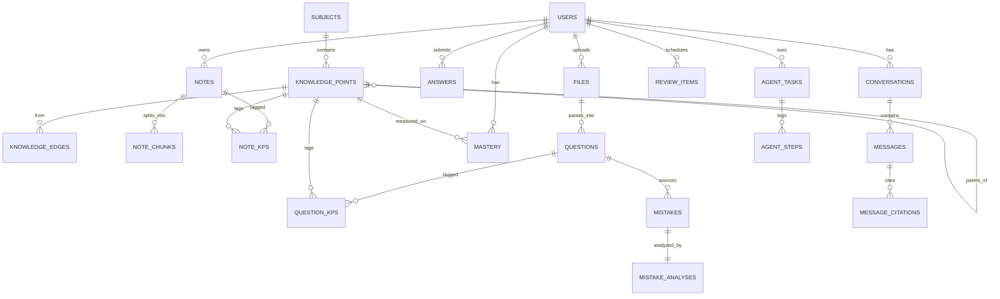

# SCHEMA.md — 数据模型契约

> 来源：《个性化学习智能体-毕业设计完整方案.md》第 5 章。本文件是建表与 Alembic 迁移的**唯一依据**，与代码冲突时以本文件为准（AGENTS.md §8）。
>
> 整理规则（S0-3 任务卡约定）：
> - 字段**全部来自方案原文**，未增删改名；
> - 方案未明示的类型/可空性/默认值按 PostgreSQL 16 惯例补齐，统一以 ⚠ 标注，**S2-1 建迁移前必须复核**；
> - 不写 SQL，只写 Markdown 表格；
> - 标记图例：✅ 方案原文明确 ｜ ⚠ 按惯例推断待复核 ｜ TODO 待后续任务定稿。

## 0. 全局约定

- 命名：表名与字段名一律 `snake_case`（与 API 命名一致，**定死**）
- 主键：统一 `id BIGINT GENERATED ALWAYS AS IDENTITY`（⚠惯例）
- 外键：`BIGINT`，命名 `<表名单数>_id`
- 时间：统一 `TIMESTAMPTZ`；`created_at` 默认 `now()`
- 软删除：`deleted_at`，检索时统一过滤（方案 5.3）
- 数组字段（方案中 `xxx[]` 写法）：`TEXT[]` / `BIGINT[]`（✅ S2-1 定稿：用原生数组，标签检索建 GIN，不转 JSONB）
- 向量维度：统一 `VECTOR(1024)`（✅ S1-3 定稿：DashScope text-embedding-v4 实测输出 1024）
- JSON 字段：统一 `JSONB`
- 金额/权重/分数：`NUMERIC`

## 1. ER 总览（方案 5.1）

## 2. 用户与权限

### 2.1 users

| 字段 | 类型 | 可空 | 默认值 | 说明 | 索引 |
|---|---|---|---|---|---|
| id | BIGINT | 否 | 自增 | 主键 | PK ⚠ |
| username | TEXT | 否 | — | 登录名 | UNIQUE ⚠ |
| password_hash | TEXT | 否 | — | 口令哈希（fastapi-users 管理） | — |
| nickname | TEXT | 否 | — | 显示昵称 | — |
| grade | TEXT | 是 | — | 年级（取值待定 TODO） | — |
| role | TEXT | 否 | 'student' ⚠ | 枚举见 §10.1 | — |
| created_at | TIMESTAMPTZ | 否 | now() | 创建时间 | — |
| updated_at | TIMESTAMPTZ | 否 | now() | 应用层 onupdate 维护（S2-1 补） | — |

### 2.2 user_relations

家长/老师绑定学生，用于查看报告（方案原文）。字段名沿用方案 `teacher_id`（语义为"查看方"，家长复用此字段）。

| 字段 | 类型 | 可空 | 默认值 | 说明 | 索引 |
|---|---|---|---|---|---|
| id | BIGINT | 否 | 自增 | 主键 | PK ⚠ |
| teacher_id | BIGINT | 否 | — | 老师/家长，FK→users | 复合 UNIQUE(teacher_id, student_id) ⚠ |
| student_id | BIGINT | 否 | — | 被绑定学生，FK→users | idx(student_id) ✅（S2-1 补） |
| created_at | TIMESTAMPTZ | 否 | now() | 创建时间（S2-1 补） | — |
| updated_at | TIMESTAMPTZ | 否 | now() | 应用层 onupdate 维护（S2-1 补） | — |

> S2-1 落库时新增 `ck_user_relations_not_self`：禁止 teacher_id = student_id。

### 2.3 subjects

| 字段 | 类型 | 可空 | 默认值 | 说明 | 索引 |
|---|---|---|---|---|---|
| id | BIGINT | 否 | 自增 | 主键 | PK ⚠ |
| name | TEXT | 否 | — | 学科名，如"数学" | — |
| code | TEXT | 否 | — | 学科代码，如 math | UNIQUE ⚠ |
| stage | TEXT | 否 | '高中' ⚠ | 学段 | — |
| config_json | JSONB | 是 | — | 难度分布/题型配比默认值 | — |
| created_at | TIMESTAMPTZ | 否 | now() | 创建时间（S2-1 补） | — |
| updated_at | TIMESTAMPTZ | 否 | now() | 应用层 onupdate 维护（S2-1 补） | — |

## 3. 知识组织

### 3.1 knowledge_points

| 字段 | 类型 | 可空 | 默认值 | 说明 | 索引 |
|---|---|---|---|---|---|
| id | BIGINT | 否 | 自增 | 主键 | PK ⚠ |
| subject_id | BIGINT | 否 | — | FK→subjects | idx ⚠ |
| parent_id | BIGINT | 是 | — | 上级知识点（根为 NULL），自引用 | idx ⚠ |
| name | TEXT | 否 | — | 知识点名称 | — |
| code | TEXT | 否 | — | 如 MATH-FUNC-012 | UNIQUE(subject_id, code) ⚠ |
| level | SMALLINT | 否 | — | 层级 1–4 ✅；`CHECK 1..4` ✅（S2-1） | — |
| description | TEXT | 是 | — | 说明 | — |
| exam_weight | NUMERIC | 是 | — | 考纲权重（复习优先级、组卷打分用） | — |
| embedding | VECTOR(1024) | 是 | — | 语义向量（对齐打分用，方案 6.2） | HNSW ✅（S2-1 建） |
| order_no | INTEGER | 否 | 0 ⚠ | 同层排序 | — |
| created_at | TIMESTAMPTZ | 否 | now() | 创建时间（S2-1 补） | — |
| updated_at | TIMESTAMPTZ | 否 | now() | 应用层 onupdate 维护（S2-1 补） | — |

> S2-1：`embedding` 列与 HNSW 索引已建，数据由 S2-10 写入；`parent_id` 自引用不设级联删除（NO ACTION），删除顺序由 S2-9 业务控制。

### 3.2 knowledge_edges

| 字段 | 类型 | 可空 | 默认值 | 说明 | 索引 |
|---|---|---|---|---|---|
| id | BIGINT | 否 | 自增 | 主键 | PK ⚠ |
| src_kp_id | BIGINT | 否 | — | 起点知识点 | 复合 UNIQUE(src_kp_id, dst_kp_id, relation) ⚠ |
| dst_kp_id | BIGINT | 否 | — | 终点知识点 | idx ⚠ |
| relation | TEXT | 否 | — | 枚举见 §10.3 | — |
| weight | NUMERIC | 是 | — | 关系强度 | — |
| source | TEXT | 否 | — | ai / manual（§10.4） | — |
| created_at | TIMESTAMPTZ | 否 | now() | 创建时间（S2-1 补） | — |
| updated_at | TIMESTAMPTZ | 否 | now() | 应用层 onupdate 维护（S2-1 补） | — |

> S2-1 新增 `ck_knowledge_edges_not_self`（src_kp_id <> dst_kp_id）；relation / source 以 CHECK 约束落库。

## 4. 笔记与文件

### 4.1 files

| 字段 | 类型 | 可空 | 默认值 | 说明 | 索引 |
|---|---|---|---|---|---|
| id | BIGINT | 否 | 自增 | 主键 | PK ⚠ |
| user_id | BIGINT | 否 | — | 上传者 | idx ⚠ |
| filename | TEXT | 否 | — | 原始文件名 | — |
| mime | TEXT | 否 | — | MIME 类型 | — |
| size | BIGINT | 否 | — | 字节数 | — |
| storage_path | TEXT | 否 | — | MinIO 对象路径 | — |
| sha256 | TEXT | 否 | — | 内容哈希（去重，方案 5.3） | UNIQUE ⚠（全局/按用户，S2-6 定） |
| parse_status | TEXT | 否 | 'pending' | 解析状态，§10.2 | idx ⚠ |
| parse_result_json | JSONB | 是 | — | 结构化解析结果（标题层级+段落+公式+题目块） | — |
| created_at | TIMESTAMPTZ | 否 | now() | 创建时间 | — |

### 4.2 notes

| 字段 | 类型 | 可空 | 默认值 | 说明 | 索引 |
|---|---|---|---|---|---|
| id | BIGINT | 否 | 自增 | 主键 | PK ⚠ |
| user_id | BIGINT | 否 | — | 所有者（检索必须过滤） | idx(user_id, subject_id) ⚠ |
| subject_id | BIGINT | 是 | — | 所属学科 | — |
| title | TEXT | 否 | — | 标题 | — |
| content_md | TEXT | 否 | — | Markdown 正文（公式为 LaTeX） | — |
| content_text | TEXT | 否 | — | 去公式纯文本，供全文检索 ✅ | — |
| tags | TEXT[] ⚠ | 是 | — | 标签 | GIN ⚠建议 |
| folder | TEXT | 是 | — | 所属笔记本/文件夹 | — |
| source_file_id | BIGINT | 是 | — | 来源文件，FK→files | — |
| created_at | TIMESTAMPTZ | 否 | now() | | — |
| updated_at | TIMESTAMPTZ | 否 | now() | 应用层维护 ⚠ | — |
| deleted_at | TIMESTAMPTZ | 是 | — | 软删除（检索时统一过滤） | — |

### 4.3 note_chunks

| 字段 | 类型 | 可空 | 默认值 | 说明 | 索引 |
|---|---|---|---|---|---|
| id | BIGINT | 否 | 自增 | 主键 | PK ⚠ |
| note_id | BIGINT | 否 | — | 所属笔记 | 复合 UNIQUE(note_id, chunk_index) ⚠ |
| user_id | BIGINT | 否 | — | 冗余存储，过滤下推（方案 5.3） | idx ⚠ |
| chunk_index | INTEGER | 否 | — | 块序号 | — |
| content | TEXT | 否 | — | 块文本 | — |
| token_count | INTEGER | 否 | — | token 数（上下文预算用） | — |
| chunk_type | TEXT | 是 | 'note' | question/note/formula（切片器判定，S4 错题诊断按 question 过滤） | — |
| heading_path | TEXT | 是 | — | 如"函数/单调性/例题2"（引用卡片显示） | — |
| embedding | VECTOR(1024) | 否 | — | 语义向量 | HNSW(vector_cosine_ops, m=16, ef_construction=64) ✅ |
| tsv | TSVECTOR | 是 | — | jieba 切词后写入（§9） | GIN ✅ |
| source_file_id | BIGINT | 是 | — | 来源文件 | — |
| page_no | INTEGER | 是 | — | 页码（引用定位） | — |
| bbox_json | JSONB | 是 | — | 原文位置框（引用高亮） | — |

> S1-3 建表时 notes/users/files 尚未建，note_id/user_id/source_file_id 暂不加外键；S2-1 复核后改为**延后到 S2-5**：时存量 83 行 `user_id=1` 无对应用户，现在加 FK 会失败，等建 notes/files 时一起补（附说明性数据迁移或先建对应用户）。

### 4.4 note_kps

| 字段 | 类型 | 可空 | 默认值 | 说明 | 索引 |
|---|---|---|---|---|---|
| note_id | BIGINT | 否 | — | 笔记 | 复合 PK(note_id, kp_id) ⚠ |
| kp_id | BIGINT | 否 | — | 知识点 | idx ⚠ |
| confidence | NUMERIC | 是 | — | 对齐置信度（0.55–0.75 进待确认队列，方案 6.2） | — |
| source | TEXT | 否 | — | ai / manual（§10.4） | — |
| confirmed | BOOLEAN | 否 | false ⚠ | 用户是否确认 | — |

## 5. 题库与错题

### 5.1 questions

| 字段 | 类型 | 可空 | 默认值 | 说明 | 索引 |
|---|---|---|---|---|---|
| id | BIGINT | 否 | 自增 | 主键 | PK ⚠ |
| subject_id | BIGINT | 否 | — | 学科 | idx ⚠ |
| origin | TEXT | 否 | — | 来源，§10.5 | idx(origin) ⚠ |
| source_file_id | BIGINT | 是 | — | 试卷切题来源文件 | — |
| stem_md | TEXT | 否 | — | 题干 Markdown | — |
| stem_latex | TEXT | 是 | — | 题干 LaTeX | — |
| options_json | JSONB | 是 | — | 选项（选择题） | — |
| answer_md | TEXT | 是 | — | 答案 | — |
| analysis_md | TEXT | 是 | — | 解析 | — |
| qtype | TEXT | 否 | — | 题型，§10.6 | idx ⚠ |
| difficulty | SMALLINT | 否 | — | 难度 1–5 ✅ | — |
| tags | TEXT[] ⚠ | 是 | — | 标签 | GIN ⚠建议 |
| verified | BOOLEAN | 否 | false | AI 生成题是否通过复算自检（方案 6.5） | — |
| embedding | VECTOR(1024) | 是 | — | 语义向量（判重/检索） | HNSW ⚠建议 |
| created_by | BIGINT | 是 | — | 创建人（AI 生成为 NULL ⚠） | — |

> 判重规则（方案 5.3）：规范化题干哈希 + 向量相似度 > 0.92。

### 5.2 question_kps

| 字段 | 类型 | 可空 | 默认值 | 说明 | 索引 |
|---|---|---|---|---|---|
| question_id | BIGINT | 否 | — | 题目 | 复合 PK(question_id, kp_id) ⚠ |
| kp_id | BIGINT | 否 | — | 知识点 | idx ⚠ |
| weight | NUMERIC | 是 | — | 关联权重（组卷配额用） | — |

### 5.3 mistakes

| 字段 | 类型 | 可空 | 默认值 | 说明 | 索引 |
|---|---|---|---|---|---|
| id | BIGINT | 否 | 自增 | 主键 | PK ⚠ |
| user_id | BIGINT | 否 | — | 所有者 | idx(user_id, status) ⚠ |
| question_id | BIGINT | 否 | — | 题目 | — |
| my_answer_md | TEXT | 是 | — | 学生作答（缺失时不猜错因，方案 6.3） | — |
| correct_answer_md | TEXT | 是 | — | 正确答案 | — |
| image_file_id | BIGINT | 是 | — | 拍照原图 | — |
| status | TEXT | 否 | '待订正' | §10.7 | — |
| correct_streak | INTEGER | 否 | 0 ⚠ | 连续答对次数 | — |
| created_at | TIMESTAMPTZ | 否 | now() | | — |
| last_review_at | TIMESTAMPTZ | 是 | — | 最近复习时间 | — |

### 5.4 mistake_analyses

| 字段 | 类型 | 可空 | 默认值 | 说明 | 索引 |
|---|---|---|---|---|---|
| id | BIGINT | 否 | 自增 | 主键 | PK ⚠ |
| mistake_id | BIGINT | 否 | — | 错题（ER 为 1:1） | UNIQUE ⚠ |
| kp_ids | BIGINT[] ⚠ | 是 | — | 定位到的知识点 | — |
| cause_type | TEXT | 否 | — | 主错因，§10.8 | — |
| error_step | TEXT | 是 | — | 第一处出错步骤（引用学生原文） | — |
| explanation_md | TEXT | 是 | — | 正确解法（分步骤 LaTeX） | — |
| similar_questions_json | JSONB | 是 | — | 2–3 道变式题 | — |
| review_advice_md | TEXT | 是 | — | 复习建议（前置知识 + 笔记关联） | — |
| model | TEXT | 否 | — | 诊断所用模型 | — |
| prompt_version | TEXT | 否 | — | Prompt 版本（prompt_templates 引用） | — |
| created_at | TIMESTAMPTZ | 否 | now() | | — |

## 6. 练习与掌握度

### 6.1 papers

| 字段 | 类型 | 可空 | 默认值 | 说明 | 索引 |
|---|---|---|---|---|---|
| id | BIGINT | 否 | 自增 | 主键 | PK ⚠ |
| user_id | BIGINT | 否 | — | 所有者 | idx ⚠ |
| title | TEXT | 否 | — | 试卷标题 | — |
| constraint_json | JSONB | 否 | — | 组卷约束（kp_ids/题型配比/难度分布/总分/时长/排除近期） | — |
| question_ids | BIGINT[] ⚠ | 否 | — | 题目 ID 有序列表 | — |
| total_score | NUMERIC | 否 | — | 总分 | — |
| duration_min | INTEGER | 是 | — | 时长（分钟） | — |
| status | TEXT | 否 | '草稿' | §10.9 | — |
| generated_by | TEXT | 否 | — | manual / ai_agent | — |
| created_at | TIMESTAMPTZ | 否 | now() | | — |

### 6.2 answers

| 字段 | 类型 | 可空 | 默认值 | 说明 | 索引 |
|---|---|---|---|---|---|
| id | BIGINT | 否 | 自增 | 主键 | PK ⚠ |
| user_id | BIGINT | 否 | — | 作答者 | idx(user_id, question_id) ⚠ |
| question_id | BIGINT | 否 | — | 题目 | — |
| paper_id | BIGINT | 是 | — | 所属试卷（非组卷练习为 NULL） | — |
| user_answer_md | TEXT | 是 | — | 作答内容 | — |
| is_correct | BOOLEAN | 是 | — | 判定结果 | — |
| score | NUMERIC | 是 | — | 得分 | — |
| self_rated | NUMERIC | 是 | — | 自评 0 / 0.5 / 1（掌握度更新输入 s，方案 6.6） | — |
| time_spent_sec | INTEGER | 是 | — | 用时（秒） | — |
| created_at | TIMESTAMPTZ | 否 | now() | | — |

### 6.3 mastery

| 字段 | 类型 | 可空 | 默认值 | 说明 | 索引 |
|---|---|---|---|---|---|
| id | BIGINT | 否 | 自增 | 主键 | PK ⚠ |
| user_id | BIGINT | 否 | — | | 复合 UNIQUE(user_id, kp_id) ✅方案明确 |
| kp_id | BIGINT | 否 | — | | — |
| mastery | NUMERIC(4,3) ⚠ | 否 | — | 掌握度 0–1；更新公式见方案 6.6 | — |
| attempts | INTEGER | 否 | 0 | 作答次数 | — |
| correct_cnt | INTEGER | 否 | 0 | 答对次数 | — |
| stability | NUMERIC | 否 | 2 | 遗忘曲线参数 S（天）：初始 2；答对 ×1.8 上限 60；答错 ×0.5 下限 1（方案 6.6）✅ | — |
| last_practice_at | TIMESTAMPTZ | 是 | — | 最近作答 | — |
| due_at | TIMESTAMPTZ | 是 | — | 下次复习到期 | idx(user_id, due_at) ⚠ |
| updated_at | TIMESTAMPTZ | 否 | now() | | — |

> 读取时按时间折算：`M_t = M · exp(−Δt / S)`（Δt 天）；到期：`interval = clamp(round(S·M_t), 1, 30)` 天（方案 6.6）。

### 6.4 review_items

| 字段 | 类型 | 可空 | 默认值 | 说明 | 索引 |
|---|---|---|---|---|---|
| id | BIGINT | 否 | 自增 | 主键 | PK ⚠ |
| user_id | BIGINT | 否 | — | | idx(user_id, due_at) ⚠ |
| kp_id | BIGINT | 否 | — | 知识点 | — |
| ref_type | TEXT | 否 | — | note / question / mistake（§10.11） | — |
| ref_id | BIGINT | 否 | — | 多态引用（对应表的 id） | — |
| due_at | TIMESTAMPTZ | 否 | — | 到期时间 | — |
| interval_days | INTEGER | 否 | — | 调度间隔（天） | — |
| priority | NUMERIC | 是 | — | 0.5·(1−M_t) + 0.3·逾期程度 + 0.2·考纲权重（方案 6.6） | — |
| done_at | TIMESTAMPTZ | 是 | — | 完成时间 | — |

## 7. 对话与引用

### 7.1 conversations

| 字段 | 类型 | 可空 | 默认值 | 说明 | 索引 |
|---|---|---|---|---|---|
| id | BIGINT | 否 | 自增 | 主键 | PK ⚠ |
| user_id | BIGINT | 否 | — | | idx ⚠ |
| title | TEXT | 是 | — | 会话标题 | — |
| scope_json | JSONB | 是 | — | 限定笔记本/学科/时间 | — |
| created_at | TIMESTAMPTZ | 否 | now() | | — |

### 7.2 messages

| 字段 | 类型 | 可空 | 默认值 | 说明 | 索引 |
|---|---|---|---|---|---|
| id | BIGINT | 否 | 自增 | 主键 | PK ⚠ |
| conversation_id | BIGINT | 否 | — | | idx ⚠ |
| role | TEXT | 否 | — | user / assistant / system（§10.12） | — |
| content_md | TEXT | 否 | — | 消息内容（Markdown） | — |
| token_usage | JSONB | 是 | — | token 用量（结构 TODO，S3-5 定） | — |
| latency_ms | INTEGER | 是 | — | 生成耗时 | — |
| model | TEXT | 是 | — | 所用模型 | — |
| prompt_version | TEXT | 是 | — | Prompt 版本 | — |
| created_at | TIMESTAMPTZ | 否 | now() | | — |

### 7.3 message_citations

| 字段 | 类型 | 可空 | 默认值 | 说明 | 索引 |
|---|---|---|---|---|---|
| id | BIGINT | 否 | 自增 | 主键 | PK ⚠ |
| message_id | BIGINT | 否 | — | 引用所属消息 | idx ⚠ |
| chunk_id | BIGINT | 是 | — | 引用的 chunk | — |
| question_id | BIGINT | 是 | — | 引用的题目 | — |
| note_id | BIGINT | 是 | — | 引用的笔记 | — |
| score | NUMERIC | 是 | — | 相关性得分 | — |
| snippet | TEXT | 是 | — | 片段（引用卡片显示） | — |
| page_no | INTEGER | 是 | — | 页码 | — |
| bbox_json | JSONB | 是 | — | 高亮位置框 | — |
| rank | INTEGER | 是 | — | 排序位次 | — |

## 8. Agent 与运维

### 8.1 agent_tasks

| 字段 | 类型 | 可空 | 默认值 | 说明 | 索引 |
|---|---|---|---|---|---|
| id | BIGINT | 否 | 自增 | 主键 | PK ⚠ |
| user_id | BIGINT | 否 | — | 发起者 | idx(user_id, status) ⚠ |
| task_type | TEXT | 否 | — | 任务类型，§10.13 | — |
| input_json | JSONB | 否 | — | 任务输入 | — |
| status | TEXT | 否 | 'pending' | §10.13 | — |
| result_json | JSONB | 是 | — | 任务结果 | — |
| error | TEXT | 是 | — | 失败原因 | — |
| steps_count | INTEGER | 是 | — | 步骤数 | — |
| token_cost | INTEGER | 是 | — | token 消耗（预算上限控制，方案 6.7） | — |
| started_at | TIMESTAMPTZ | 是 | — | 开始时间 | — |
| finished_at | TIMESTAMPTZ | 是 | — | 结束时间 | — |

### 8.2 agent_steps

| 字段 | 类型 | 可空 | 默认值 | 说明 | 索引 |
|---|---|---|---|---|---|
| id | BIGINT | 否 | 自增 | 主键 | PK ⚠ |
| task_id | BIGINT | 否 | — | 所属任务 | 复合 UNIQUE(task_id, step_no) ⚠ |
| step_no | INTEGER | 否 | — | 步骤序号（可回放，答辩演示） | — |
| thought | TEXT | 是 | — | 规划/反思内容 | — |
| tool_name | TEXT | 是 | — | 调用的工具（§工具清单见方案 6.7） | — |
| tool_input_json | JSONB | 是 | — | 工具入参 | — |
| tool_output_json | JSONB | 是 | — | 工具出参 | — |
| latency_ms | INTEGER | 是 | — | 耗时 | — |
| status | TEXT | 是 | — | 步骤状态（取值 TODO，S6-2 定） | — |

### 8.3 prompt_templates

| 字段 | 类型 | 可空 | 默认值 | 说明 | 索引 |
|---|---|---|---|---|---|
| id | BIGINT | 否 | 自增 | 主键 | PK ⚠ |
| name | TEXT | 否 | — | Prompt 名称 | 复合 UNIQUE(name, version) ⚠ |
| version | TEXT | 否 | — | 版本号（论文做"迭代 3 版效果对比"） | — |
| content | TEXT | 否 | — | Prompt 正文 | — |
| variables_json | JSONB | 是 | — | 模板变量 | — |
| model_hint | TEXT | 是 | — | 适用模型 | — |
| is_active | BOOLEAN | 否 | false ⚠ | 当前生效版本 | — |
| created_by | BIGINT | 是 | — | 创建人 | — |

### 8.4 llm_call_logs

| 字段 | 类型 | 可空 | 默认值 | 说明 | 索引 |
|---|---|---|---|---|---|
| id | BIGINT | 否 | 自增 | 主键 | PK ⚠ |
| user_id | BIGINT | 是 | — | 发起用户（系统调用为 NULL ⚠） | idx(user_id, created_at) ⚠ |
| scene | TEXT | 否 | — | qa / mistake / gen / agent / embed（§10.14） | idx ⚠ |
| model | TEXT | 否 | — | 模型名 | — |
| prompt_tokens | INTEGER | 是 | — | 输入 token | — |
| completion_tokens | INTEGER | 是 | — | 输出 token | — |
| cost | NUMERIC | 是 | — | 费用 | — |
| latency_ms | INTEGER | 是 | — | 延迟 | — |
| trace_id | TEXT | 是 | — | 链路追踪（S0-5 日志中间件注入） | idx ⚠ |
| status | TEXT | 否 | — | 成功/失败（取值 TODO，S3-7 定） | — |
| created_at | TIMESTAMPTZ | 否 | now() | | — |

### 8.5 eval_runs

| 字段 | 类型 | 可空 | 默认值 | 说明 | 索引 |
|---|---|---|---|---|---|
| id | BIGINT | 否 | 自增 | 主键 | PK ⚠ |
| dataset_name | TEXT | 否 | — | 评测集名 | — |
| config_json | JSONB | 否 | — | 配置（如 hybrid_rerank） | — |
| metrics_json | JSONB | 否 | — | 指标结果（真实实测数字） | — |
| created_at | TIMESTAMPTZ | 否 | now() | | — |

## 9. 索引与检索策略（方案 5.3 摘要）

- **向量**：`note_chunks.embedding` 用 HNSW（`m=16, ef_construction=64`）；数据量 < 10 万时 HNSW 更省心、召回稳；备选 `ivfflat lists=100`。
- **全文**：`note_chunks.tsv = to_tsvector('simple', content)`；中文无内置分词，**jieba 写入时切好词、空格连接后入库**，查询同样 jieba 切词拼 `tsquery`；建 GIN 索引；零依赖兜底方案为 2-gram（精度不如分词）。
- **过滤维度**：`user_id / subject_id / kp_id / 时间范围` 必须下推到检索 SQL，避免"先检索全库再过滤"。
- **去重**：文件按 `sha256`；题目按"规范化题干哈希 + 向量相似度 > 0.92"。
- **软删除**：`deleted_at`，检索时统一过滤。

## 10. 枚举值

| # | 字段 | 取值 | 依据 |
|---|---|---|---|
| 10.1 | users.role | student / teacher / parent / admin ✅（S2-1 以 `ck_users_role` 落库定稿） | 依据 user_relations 与 /admin/usage 接口推断 |
| 10.2 | files.parse_status | pending / done（中间态与失败态 TODO，S2-8 定） | 方案 6.1 流水线 |
| 10.3 | knowledge_edges.relation | prerequisite / related / confusable / contains ✅ | 方案 5.2 |
| 10.4 | note_kps.source、knowledge_edges.source | ai / manual ✅ | 方案 5.2 |
| 10.5 | questions.origin | textbook / exam / mock / upload / ai ✅ | 方案 5.2 |
| 10.6 | questions.qtype | 单选 / 多选 / 填空 / 解答 ✅ | 方案 5.2 |
| 10.7 | mistakes.status | 待订正 / 已订正 / 已掌握 ✅ | 方案 5.2 |
| 10.8 | mistake_analyses.cause_type | 概念不清 / 计算失误 / 审题偏差 / 方法不当 / 知识遗忘 / 时间不足 / unknown ✅（unknown：作答缺失时不猜错因，方案 6.3） | 方案 5.2 + 6.3 |
| 10.9 | papers.status | 草稿 / 已生成 / 已提交 ✅；generated_by：manual / ai_agent ✅ | 方案 5.2 |
| 10.10 | answers.self_rated | 0 / 0.5 / 1 ✅ | 方案 5.2 + 6.6 |
| 10.11 | review_items.ref_type | note / question / mistake ✅ | 方案 5.2 |
| 10.12 | messages.role | user / assistant / system ✅ | 方案 5.2 |
| 10.13 | agent_tasks.status | pending / running / waiting_confirm / succeeded / failed ✅；task_type 首批：weekly_mindmap / mistake_paper（见 API 草案） | 方案 5.2 + 附录 B |
| 10.14 | llm_call_logs.scene | qa / mistake / gen / agent / embed ✅ | 方案 5.2 |

---

> 维护规则（AGENTS.md）：SCHEMA.md 由用户维护，AI 只能读；需求变更先改这里，再生成 Alembic 迁移；禁止修改已提交的迁移文件。
