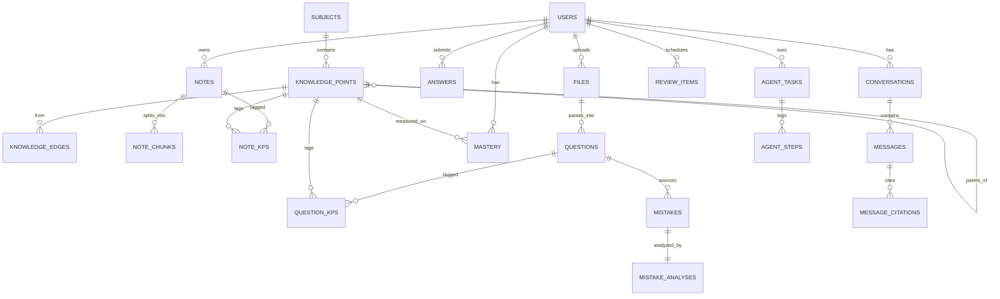
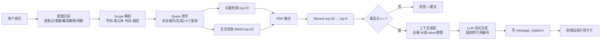

# 个性化学习智能体的设计与实现
## 毕业设计完整方案（融合 RAG / 知识图谱 / Agent 的 Web 应用）

| 项目 | 内容 |
|---|---|
| 选题名称 | 个性化学习智能体的设计与实现 |
| 学生 | 计科 2304 何潇 |
| 指导教师 | 赵良 |
| 目标用户 | 高中生（高二/高三复习场景）及其家长/老师 |
| 文档用途 | 开题准备、技术选型、开发排期、论文与答辩规划 |
| 版本 | v1.0 |

> 阅读顺序建议：**第 0 章（一页速览）→ 第 2 章（范围边界）→ 第 8 章（开发计划）→ 其余按需**。
> 时间紧的时候，只要第 0、2、8 章就能开工。

---

## 0. 一页速览（TL;DR）

**一句话定位**：把"学生的笔记 + 错题 + 试卷 + 教材考纲"变成结构化知识资产，用 RAG 做可溯源的问答，用知识图谱和掌握度模型做个性化复习推荐，用 Agent 把"多步的整理与出题任务"自动化。

**核心能力（6 条）**

1. **多模态笔记管理**：文字 / 图片 / PDF / 拍照试卷录入，公式与题目结构化，按知识点自动归档。
2. **AI 知识点抽取与知识图谱**：从笔记与试卷中抽取知识点，对齐到标准知识点树（考纲/教材目录），构建"前置-相关-易混淆"关系。
3. **AI 错题分析**：错因定位（知识点 + 错因类型 + 第一处错误步骤）、同类变式题生成、关联笔记与前置知识。
4. **个人笔记知识库 RAG 问答**：混合检索 + 重排 + 引用溯源，答案能点回原文位置；检索不到就明确拒答。
5. **试题生成与自适应组卷**：按知识点覆盖度、难度分布、题型配比自动组卷，可导出 PDF 打印。
6. **个性化复习计划**：掌握度模型 + 遗忘曲线调度，输出"今日复习清单"与学习报告/思维导图。

**技术栈一行版**：`Vue3 + TS + Element Plus` ｜ `FastAPI + SQLAlchemy2 + Alembic` ｜ `PostgreSQL16 + pgvector` ｜ `Redis + ARQ + APScheduler` ｜ `MinIO` ｜ `DeepSeek-V3(对话) + 厂商 Embedding/Rerank API` ｜ `Docling(文档解析) + 多模态 API(图片试卷) + jieba(分词) + Playwright(PDF导出)` ｜ `LangGraph(Agent)` ｜ `Docker Compose + Nginx`

**开发总原则（复用优先）**：**能用成熟库/API 的，绝不自己写**。只有论文创新点那 9 块自己实现（见 4.3.1）。这条原则贯穿全文选型：不装 PaddleOCR（换多模态 API）、不折腾 WeasyPrint（换 Playwright）、不手写中文分词（用 jieba）、不下载本地模型（先用厂商 API）。

**MVP 边界（必须做完，也是论文主体）**：笔记 CRUD → 文档解析入库 → RAG 问答（含引用）→ 错题本 + AI 错题分析 → 掌握度 + 复习计划。
**进阶（有能力再上，是加分项）**：知识图谱可视化、Agent 多步任务（自动整理 + 思维导图 + 自动组卷）、学习报告、多学科扩展。

**周期与里程碑**：8 个月 / 32 周 / 7 个里程碑（M0 技术验证 → M6 论文答辩）。
**论文创新点（3 条，小而实）**：① 学科知识点树约束的检索增强问答（把"图谱先验"注入检索与重排）；② 错题驱动的掌握度建模与自适应组卷 Agent；③ 面向 K12 的强制可溯源问答机制（引用 + 拒答 + 原文定位）。
**预算量级**：云服务器 4C8G ≈ 60–150 元/月；大模型 API 全周期 ≈ 200–500 元（以官网价目为准）；其余全用开源。
**差异化**：数据是真实的（教材目录、考纲、历年真题、平时试卷），且由本人以真实复习流程持续自测，这是多数毕设没有的。

---

## 1. 选题背景与定位

### 1.1 与导师沟通结论的提炼

聊天里已经形成了明确共识，这里把"口头共识"固化成可执行的需求：

| 导师关注点（原话要点） | 方案中的落地方式 |
|---|---|
| "做高中内容"（首版聚焦高中数学） | 首版学科聚焦**高中数学**（单一学科打通闭环），内容层做成可配置，换学科只换知识树与题库 |
| "个性化复习 / 学习更有目标，不盲目" | 复习计划模块：掌握度模型 + 遗忘曲线 + 考纲权重 → 每日清单 |
| "框架是一样的，做成之后可以针对任何一门课程" | 知识点树、题库存为"学科维度"数据，不硬编码；预留多学科切换 |
| "需要教材信息、考试大纲、近几年真题、模拟题、学生试卷、练习册" | 语料分层：**公共语料**（教材/考纲/真题）+ **私人语料**（学生笔记/错题/试卷），分库或分区，权限与版权分离 |
| "问答系统已经很简单了，肯定要往智能体靠" | Agent 作为 M4 阶段目标：多步任务（整理笔记→聚类→生成思维导图；错题→选题→组卷） |
| "抓取底层知识点、知识点之间的关联、推荐重难点、生成试题" | 知识图谱模块 + 掌握度推荐 + 试题生成模块，与导师原话一一对应 |
| "要考虑真正能用" | 非功能需求章节（性能、成本、可用性）+ 本人长期自测 + 验收标准 |

### 1.2 真实痛点

- **笔记是死的**：记完就不再看，无法检索、无法复用，复习时找不到"我当时是怎么想的"。
- **错题订正流于形式**：抄一遍答案，不知道错在哪个知识点、为什么错、还会不会再错。
- **复习没有优先级**：不知道哪块弱、哪块该先看，时间平摊，效率低。
- **题库/教辅是通用品**：给的是"所有人都要做的题"，不是"你该做的题"。
- **AI 直接问答不可信**：通用大模型会编、会算错、不知道学生自己的笔记内容，且答案没有出处。

### 1.3 同类产品调研与差异化

| 产品 | 形态 | 借鉴点 | 本项目的差异 |
|---|---|---|---|
| Anki / 墨墨 | 卡片 + 间隔重复 | 复习调度算法（SM-2/FSRS） | 它是人工制卡，本项目**自动从笔记/错题生成复习项** |
| 传统错题本 App | 拍照 + 标签 | 错题归档交互 | 多了**AI 错因诊断 + 变式题生成 + 掌握度更新** |
| 通用 AI 助手（豆包/Kimi/DeepSeek 网页版） | 对话 | 交互范式 | 无个人知识库、无引用溯源、无学习数据沉淀 |
| Notion AI / 飞书知识问答 | 文档 + RAG | RAG 交互设计 | 面向通用办公，无学科知识树、无掌握度与组卷 |
| Khanmigo / 松鼠 AI 等 | 智能教培 | 自适应学习理念 | 商业闭源、黑盒；本项目**全栈自主实现 + 可解释的模型与引用** |

**差异化一句话**：**"可溯源 + 学科图谱约束 + 错题驱动"的私有知识库学习系统**，而不是又一个套壳聊天框。

### 1.4 选题意义

- **工程价值**：完整走一遍"数据采集 → 结构化 → 检索增强生成 → 智能体编排 → 评测调优 → 部署上线"的 AI 应用全链路，覆盖 RAG、Agent、知识图谱、推荐算法等当前主流技术。
- **实际价值**：面向高二/高三的真实复习流程，有明确的时间窗口和检验标准（能不能真的提高复习效率）。
- **可推广性**：换学科知识树即可复用，具备"个性化教培"的产品雏形（导师原话："我都觉得可以推广的"）。

> 论文里的表述要克制：不写"提升学习成绩 X%"，而写"验证系统在真实复习流程中的可用性与问答可靠性"。成绩提升涉及太多混杂因素，不是本科毕设能证明的，硬写会被答辩老师追问。

---

## 2. 目标与范围

### 2.1 建设目标（可验证）

1. 搭建一个可公网访问（或局域网演示）的 Web 系统，支持学生自主录入笔记、试卷、错题。
2. 实现基于个人知识库的问答，**答案必须给出可点击的原文引用**；无依据时拒答。
3. 实现错题自动诊断：定位知识点、判定错因类型、生成 2–3 道变式题。
4. 实现知识点掌握度建模，按遗忘曲线生成每日复习清单。
5. 实现按约束自动组卷（知识点覆盖 / 难度分布 / 题型配比 / 去重）。
6. 在 Agent 模式下完成至少 2 个多步任务：**周笔记整理 + 思维导图生成**、**基于错题自动组卷**。
7. 建成一套可复现的自测用例与抽查脚本，检查检索与生成质量。

### 2.2 用户角色

| 角色 | 说明 | 核心诉求 |
|---|---|---|
| 学生（主用户） | 高二/高三学生 | 录笔记、拍错题、问问题、按清单复习、打印卷子 |
| 家长/老师（次用户） | 家长或老师（只读查看） | 看学生的学习报告、掌握度分布、薄弱点，导出试卷 |
| 管理员（自己） | 系统维护 | 学科/知识树/题库维护、Prompt 与模型配置、用量与成本监控 |

> 权限模型保持简单：`student` / `teacher`（只读查看绑定学生）/ `admin`，用 RBAC 三张表（user / role / user_role）即可，不做复杂组织架构。

### 2.3 范围边界

**做（In Scope）**
- 单学科（数学）打通的完整闭环，架构支持多学科。
- Web 端（桌面优先，响应式兼容平板/手机浏览器）。
- 文本 + 图片 + PDF 录入；公式用 LaTeX 表示与渲染。
- 私有知识库 RAG、错题分析、组卷、复习计划、Agent 任务。
- 单人使用为主的部署（不做高并发在线课堂）。

**不做（Out of Scope，明确写进论文"范围限定"）**
- 不训练/微调自己的大模型（只做 RAG + Prompt + Agent 编排）。
- 不做原生 App（微信小程序/安卓）——时间不够，H5 响应式足够。
- 不做实时直播、在线课堂互动、作业批改等社交/教务功能。
- 不做多租户 SaaS 计费体系。
- 不做自动爬取全网题库（版权风险），只做**授权/自有语料 + 公开考纲结构**。
- 不宣称替代老师，定位为"复习效率工具"。

### 2.4 需求分级（P0 / P1 / P2）

| 优先级 | 模块 | 说明 |
|---|---|---|
| **P0** | 用户与登录、笔记 CRUD、文件上传与解析、知识点标签 | 地基，做不完其他都别谈 |
| **P0** | RAG 问答（检索 + 引用 + 流式） | 论文核心之一 |
| **P0** | 错题本 + AI 错题分析 | 论文核心之二 |
| **P0** | 掌握度 + 每日复习清单 | 个性化落点 |
| **P1** | 知识图谱构建与可视化 | 中期主力 |
| **P1** | 试题生成 + 自适应组卷 + PDF 导出 | 导师明确关心 |
| **P1** | 学习报告（周报/掌握度雷达图） | 复习复盘刚需 |
| **P2** | Agent 多步任务 / 思维导图 | 加分项，最后阶段做 |
| **P2** | 多学科扩展、移动端优化、语音输入 | 有余力再说 |

---

## 3. 需求分析

### 3.1 主要用例

| 编号 | 用例 | 参与者 | 简述 |
|---|---|---|---|
| UC-01 | 录入笔记 | 学生 | 富文本/Markdown 编辑，插入图片、公式、附件 |
| UC-02 | 拍照上传试卷 | 学生 | 上传图片 → OCR/多模态解析 → 自动切成"题目"结构 |
| UC-03 | 自动知识点标注 | 系统 | 每篇笔记/每道题自动关联 1–5 个知识点，可人工修正 |
| UC-04 | 知识库问答 | 学生 | 提问 → 检索个人知识库 → 流式回答 + 引用卡片 |
| UC-05 | 查看引用原文 | 学生 | 点击引用 → 跳到原文对应位置并高亮 |
| UC-06 | 错题诊断 | 学生 | 录入错题与自己的作答 → 得到错因、正确解、变式题 |
| UC-07 | 生成复习清单 | 系统 | 每日按掌握度与到期时间生成待复习项 |
| UC-08 | 自动组卷 | 学生/家长 | 指定范围与难度 → 生成试卷 → 预览/导出 PDF |
| UC-09 | 查看学习报告 | 家长 | 掌握度热力图、薄弱知识点、近两周趋势 |
| UC-10 | Agent 多步任务 | 学生 | 如"整理上周笔记并生成思维导图" |

### 3.2 功能需求清单（按模块）

**A. 内容录入**
- A1 笔记：Markdown + 所见即所得；支持代码块、公式块（`$...$` / `$$...$$`）、图片、表格。
- A2 附件：PDF / Word / 图片 / TXT，单文件 ≤ 50MB。
- A3 试卷：图片或 PDF，支持"整卷切题"（切成独立题目对象）。
- A4 标签与折叠：学科、章节、自定义标签、收藏、回收站。
- A5 公式：渲染用 KaTeX；录入支持直接敲 LaTeX，图片公式走多模态识别。

**B. 知识组织**
- B1 知识点树：学科 → 模块（函数/数列/立体几何…）→ 章节 → 知识点 → 子知识点（建议 3–4 层）。
- B2 知识点对齐：AI 抽取 + 向量相似度匹配到标准知识点；置信度低的进"待确认"队列人工确认。
- B3 图谱关系：`prerequisite`（前置）、`related`（相关）、`confusable`（易混淆）、`contains`（包含）。
- B4 可视化：力导向图（ECharts graph），按掌握度上色。

**C. 问答（RAG）**
- C1 支持范围选择：全部知识库 / 指定笔记本 / 指定学科 / 指定时间范围。
- C2 流式输出（SSE），首字延迟目标 < 2s。
- C3 每条结论带引用编号，引用可点回原文（文件 + 页码 + 高亮片段）。
- C4 多轮对话，追问时保留上下文并重新检索（query 改写）。
- C5 无依据时拒答："在你的笔记中没找到相关内容"，并给出建议（换个问法 / 去看看某知识点）。
- C6 历史会话管理，可收藏、可导出。

**D. 错题与分析**
- D1 错题录入：题目 + 我的答案 + 正确答案（可选），或从试卷切题直接标记。
- D2 诊断输出：知识点定位、错因类型、错误步骤定位、正确解法、易错提醒。
- D3 变式题：2–3 道同知识点变式（含答案与解析），可一键加入练习。
- D4 错题状态机：`待订正 → 已订正 → 已掌握`（连续答对 2 次自动置为已掌握）。
- D5 错题统计：按知识点 / 错因类型 / 时间维度聚合。

**E. 练习与组卷**
- E1 题库：来源分为"真题 / 教材题 / 生成题 / 学生上传题"，带难度（1–5）、题型、知识点、答案、解析。
- E2 生成题：由 LLM 生成并标注"AI 生成"，需人工或规则校验后入库。
- E3 组卷约束：知识点覆盖清单、难度分布、题型配比、总分、时长、排斥近期做过的题。
- E4 在线作答（客观题自动判分，主观题自评）→ 结果回写掌握度。
- E5 导出 PDF（A4 双栏/单栏，题干与答案分离）。

**F. 复习与报告**
- F1 今日复习清单（含预计耗时）。
- F2 掌握度看板：雷达图（按模块）+ 热力图（按知识点）。
- F3 周报：新增笔记数、错题数、复习完成率、薄弱点变化。
- F4 思维导图：Mermaid 渲染，可导出 PNG/SVG。

**G. 系统**
- G1 模型配置：切换对话/向量模型、调整 temperature、上下文 token 预算。
- G2 Prompt 管理：模板版本化、可编辑、可回滚（改动留痕，论文里就是"Prompt 工程实践"）。
- G3 用量与成本统计：按用户/按天统计 token 与费用（答辩很加分，说明你真在工程化地跑）。
- G4 日志与追踪：每次请求的检索命中、耗时、token、模型、Prompt 版本。

### 3.3 非功能需求

| 类别 | 指标 | 落地手段 |
|---|---|---|
| 性能 | 问答首字 < 2s；完整回答 P95 < 15s；页面接口 P95 < 300ms | 流式 SSE、检索缓存、异步解析、DB 索引 |
| 并发 | 支持 20 并发问答不报错（毕设级） | FastAPI async + 连接池 + 限流 |
| 成本 | 单次问答 ≤ 0.02 元；全周期 API 预算 ≤ 500 元 | 上下文裁剪、结果缓存、便宜模型做粗活 |
| 可用性 | 单机 Docker 部署，一键 `docker compose up -d` 起全栈 | 容器化 + 健康检查 + 启动脚本 |
| 数据安全 | 学生数据仅本人与绑定家长可见；不上传第三方训练 | 行级权限、脱敏日志、导出/删除功能 |
| 可维护 | 模块解耦，AI 能力集中在 `ai/` 层，换模型不改业务代码 | 适配器模式封装 LLM/Embedding/Rerank |
| 可观测 | 每次 LLM 调用有日志与 trace_id | `llm_call_logs` 表 + 简单看板 |
| 兼容 | Chrome/Edge 最新版，平板可用 | 响应式布局 + 移动端适配 |

### 3.4 关键业务规则（论文里要写成算法/规则）

1. **引用强制**：凡是"来自知识库"的陈述必须带引用；没有检索到（最高重排分 < 阈值 τ）就走拒答分支。
2. **AI 输出分级**：`AI 生成` 的题目/解析必须打标，且默认不直接计入掌握度计算（需要学生确认）。
3. **掌握度更新规则**：只有"作答/自评/错题订正"这三类行为才更新掌握度；AI 生成的题需学生实际作答。
4. **复习调度规则**：到期日 + 掌握度共同决定推荐顺序；掌握度 < 0.4 的知识点每天都出现在清单里。
5. **数据隔离**：所有检索必须带 `user_id` 过滤（个人知识库）或 `scope=public`（公共语料），二者结果分区展示。

---

## 4. 总体架构

### 4.1 系统架构图

```mermaid
flowchart TB
    subgraph Client["前端 Vue3 + TS"]
        A1[笔记编辑器] --- A2[问答界面] --- A3[错题本] --- A4[练习/组卷] --- A5[学习报告] --- A6[知识图谱]
    end

    subgraph Gateway["接入层 Nginx"]
        G1[静态资源 / 反向代理 / SSE 透传 / 限流]
    end

    subgraph API["应用层 FastAPI"]
        B1[认证与权限]
        B2[笔记与文件服务]
        B3[知识组织服务]
        B4[问答服务 RAG]
        B5[错题分析服务]
        B6[练习与组卷服务]
        B7[复习调度服务]
        B8[Agent 编排 LangGraph]
    end

    subgraph AI["AI 能力层 ai/"]
        C1[LLM 适配器<br/>DeepSeek / Qwen]
        C2[Embedding 适配器<br/>厂商 API（默认）/ 本地模型（可选）]
        C3[Rerank 适配器<br/>厂商 API（默认）/ 本地模型（可选）]
        C4[文档解析 Docling/Marker<br/>图片试卷 → 多模态 API]
        C5[Prompt 管理(Jinja2) + 结构化输出校验]
    end

    subgraph Worker["异步任务层"]
        W1[ARQ Worker<br/>文档解析·多模态识别·批量标注·组卷]
        W2[APScheduler 定时任务<br/>复习调度·周报生成·用量汇总]
    end

    subgraph Data["数据层"]
        D1[(PostgreSQL 16 + pgvector<br/>业务数据 + 向量 + 全文索引)]
        D2[(Redis<br/>缓存 / 队列 / 限流)]
        D3[(MinIO / 本地磁盘<br/>原始文件)]
    end

    Client --> Gateway --> API
    API --> AI
    API --> Data
    API --> Worker
    Worker --> AI
    Worker --> Data
```

### 4.2 分层职责

| 层 | 职责 | 关键约束 |
|---|---|---|
| 表现层 | 交互、流式渲染、Markdown/公式/图表 | 不写业务逻辑；所有 AI 调用走后端，前端不持有 API Key |
| 接入层 | 路由、鉴权透传、SSE、限流 | SSE 必须关闭缓冲（`proxy_buffering off`），否则流式会断 |
| 应用层 | 业务编排、权限、事务 | 每个模块一个 service，AI 调用只依赖 `ai/` 的接口 |
| AI 能力层 | 模型调用、Prompt、结构化解析、检索算法 | 统一 `LLMClient` 接口，模型可热切换；所有调用记录日志 |
| 异步层 | 重活离屏：解析、OCR、批量标注、组卷、报告 | 任务幂等 + 失败重试 + 状态可查 |
| 数据层 | 关系数据、向量、全文、文件、缓存 | 向量与关系同库（pgvector）降低部署复杂度 |

### 4.3 技术选型与理由

| 领域 | 候选 | 选择 | 理由 |
|---|---|---|---|
| 前端框架 | Vue3 / React / Next.js | **Vue3 + Vite + TS** | 中文生态好、上手快、组件库成熟；毕设以功能为主，不做 SSR |
| UI 库 | Element Plus / Naive UI / AntDV | **Element Plus** | 组件全（上传、表格、树、抽屉），文档中文完善 |
| 编辑器 | md-editor-v3 / Vditor / TipTap | **md-editor-v3** | 原生 Markdown + KaTeX 公式 + 图片上传，开箱即用 |
| 图表 | ECharts / AntV G6 | **ECharts**（雷达/热力/趋势）+ **G6 或 ECharts graph**（图谱） | 一套库搞定，学习成本低 |
| 后端 | FastAPI / Spring Boot / NestJS | **FastAPI (Python 3.11)** | AI 生态最强（LangGraph、多模态模型 SDK、pgvector 客户端全在 Python），异步原生，开发速度快 |
| ORM/迁移 | SQLAlchemy 2.0 + Alembic | 同左 | 类型友好，迁移可控 |
| 认证与权限 | fastapi-users / 手写 JWT | **fastapi-users**（或 FastAPI 官方安全教程代码） | 注册/登录/JWT/密码哈希全套现成，只需接自己的用户表；不要手写令牌与哈希 |
| 数据库 | PostgreSQL / MySQL + 独立向量库 | **PostgreSQL 16 + pgvector** | 一个库同时做关系、JSONB、全文检索、向量检索，避免维护 Milvus/ES，毕设性价比最高 |
| 中文分词 | jieba / zhparser / 手写 bigram | **jieba**（写入时切词，空格连接存 `tsv`） | 成熟稳定的 Python 库，一行调用；避免编译 PostgreSQL 扩展 |
| 缓存/队列 | Redis + Celery/ARQ + APScheduler | **Redis + ARQ**（轻）或 Celery + **APScheduler**（定时） | 文档解析/多模态识别必须异步，否则接口超时；定时任务用现成的 APScheduler |
| 对象存储 | MinIO / 本地磁盘 / OSS | **MinIO（Docker）**，MVP 可直接落磁盘 | 免云厂商依赖，本地可跑 |
| 对话模型 | DeepSeek-V3 / Qwen-Plus / GLM | **DeepSeek-V3（OpenAI 兼容接口）**，备用 Qwen | 中文强、便宜、接口兼容，换供应商只改 base_url |
| 文档解析 | Docling / Marker / PyMuPDF | **Docling 或 Marker（现成解析器）**，PyMuPDF 兜底 | 开箱输出带标题层级与表格的 Markdown，省掉手写版面启发式；均开源可本地跑，纯文本/简单 PDF 用 PyMuPDF 更快 |
| 向量模型 | 厂商 API / 本地 bge-m3 | **厂商 Embedding API（默认）**，后期可切本地 bge-m3 | 零下载、零安装、不占内存、按量付费极便宜；本地化留作后期成本优化，不阻塞前期进度，也就不用碰 HuggingFace |
| 重排模型 | 厂商 Rerank API / 本地 bge-reranker | **厂商 Rerank API（默认）**，后期可切本地 | 重排是 RAG 质量提升性价比最高的一环，先接上再谈本地化 |
| 图片/试卷识别 | 多模态 API / PaddleOCR / pix2tex | **多模态大模型 API 整题识别**（Qwen-VL / GLM-4V / 豆包视觉） | 直接输出 LaTeX 结构化题目；不装 PaddleOCR，规避 Windows 编译与 Python 版本适配问题 |
| PDF 导出 | Playwright / WeasyPrint / reportlab | **Playwright（浏览器打印 HTML）** | 自动下载浏览器内核，无 GTK 运行库依赖，中文与公式渲染最省心 |
| Agent 编排 | 手写 ReAct / LangChain Agent / LangGraph | **LangGraph**（状态机 + 可中断 + 可持久化） | 多步任务需要状态、重试、人工确认，LangGraph 最贴合；也是论文亮点 |
| 部署 | Docker Compose / K8s | **Docker Compose + Nginx** | 单机足够，K8s 是过度设计 |

> **关于"要不要用 LangChain"**：建议**检索链路自己写**（切片、混合检索、RRF 融合代码不长，可控、可写进论文），**Agent 用 LangGraph**。全量依赖框架会导致"论文里讲不清自己做了什么"，这是答辩常见扣分点。

### 4.3.1 复用优先原则（能用现成的就别自己写）

**判断标准：这个库会不会接管我的主流程？**

| 类型 | 态度 | 例子 |
|---|---|---|
| 原子能力库 | ✅ 直接复用 | PyMuPDF、jieba、KaTeX、bcrypt、tiktoken |
| 基础设施 | ✅ 直接复用 | Docker、PostgreSQL、Redis、Nginx、MinIO |
| 业务脚手架 | ✅ 直接复用 | FastAPI、SQLAlchemy、Element Plus、Playwright |
| 接管主流程的框架 | ⚠️ 谨慎，最多用在 Agent 层 | LangChain 全家桶、LlamaIndex |

**三个判断问题**（任一条答"不能"，就换掉或自己写）：

1. 它出错时，我能看到中间结果吗？
2. 我要改它的默认行为时，容易吗？
3. 论文里我能说清"这一层我做了什么"吗？

**本项目"直接复用"清单（避免重复造轮子）**

| 需求 | 复用现成方案 | 不要去自己写 |
|---|---|---|
| PDF/Word 结构化解析 | **Docling / Marker**（PyMuPDF 兜底） | 字号/加粗启发式还原标题层级 |
| 图片、试卷识别（含公式） | **多模态大模型 API** | PaddleOCR + pix2tex 拼装 |
| 中文分词 | **jieba** | 手写 2-gram 切分 |
| 向量化 / 重排 | **厂商 Embedding / Rerank API** | 本地模型下载、加载与推理调度（后期可选） |
| 认证与权限 | **fastapi-users** / FastAPI 官方安全示例 | 手写令牌、哈希、权限判定 |
| 分页与排序 | **fastapi-pagination** | 手写分页 SQL 与排序白名单 |
| Prompt 模板渲染 | **Jinja2** | 手写 `{{var}}` 正则替换 |
| 结构化输出与重试 | **instructor**（或 Pydantic + 重试装饰器） | 手写 JSON 修复逻辑 |
| 定时任务 | **APScheduler** | 手写 sleep 循环或裸 cron |
| PDF 导出 | **Playwright**（浏览器打印） | 折腾 WeasyPrint 的 GTK 依赖 / 手写排版 |
| RAG 指标计算 | **自己写**（自测规模只需检查前5条是否命中、引用是否正确）；后期要量化再引入 RAGAS | — |
| 表格 / 图表 / 图谱渲染 | **Element Plus + ECharts / G6** | 手写组件与力导向布局算法 |

**必须自己写的只有 9 块**（论文创新点所在）：切片策略、混合检索与 RRF 融合、上下文组装与引用校验/拒答、知识点对齐打分、错因诊断与题目复算自检、掌握度模型与遗忘调度、自适应组卷、Agent 工具与状态机、自测用例与抽查脚本。

**两个复用陷阱**

- **"以为自己会了"**：框架把 RAG 跑通了，但你说不清 embedding 与检索原理——答辩现场会崩。
- **版本漂移**：LangChain 这类库半年一变，8 个月的项目周期里，教程代码过期是常态。

### 4.4 模型分工表

| 任务 | 模型/方案 | 说明 |
|---|---|---|
| 对话问答、错题讲解 | DeepSeek-V3（chat） | 主力，temperature 0.3 |
| 结构化抽取（知识点、题干、错因） | DeepSeek-V3 + JSON Schema 强约束 | 要求返回严格 JSON，用 Pydantic 校验，失败重试 2 次 |
| 题目生成/变式 | DeepSeek-V3（temperature 0.7） | 生成后必须有自检步骤（见 7.2） |
| 图片/试卷识别 | 多模态模型（Qwen-VL / GLM-4V / 豆包视觉） | 输出结构化 LaTeX 题目 |
| 向量化 | 厂商 Embedding API（默认）；后期可切本地 bge-m3 | 维度以所选模型实际输出为准（常见 1024/768）；批处理 32 条/次 |
| 重排 | 厂商 Rerank API（默认）；后期可切本地 bge-reranker | top-30 → top-6 |
| 查询改写/意图分类 | 小模型或 DeepSeek 低 token 调用 | 可缓存，成本极低 |

**成本控制原则**：能被规则/缓存/小模型解决的，绝不调用大模型。

### 4.5 部署架构

单台云服务器（4C8G / 100G SSD，Ubuntu 22.04）：

```yaml
# docker-compose 服务清单（示意）
services:
  nginx:      # 443 入口，静态资源 + /api 反代 + SSE 透传
  web:        # Vue 构建产物（也可直接由 nginx 托管）
  api:        # FastAPI (uvicorn/gunicorn)，2 workers
  worker:     # ARQ/Celery：解析、OCR、批量标注、组卷
  scheduler:  # 定时任务：复习调度、周报、用量汇总
  postgres:   # postgres:16 + pgvector 扩展，挂载 volume
  redis:      # 缓存/队列
  minio:      # 文件对象存储
```

配套：`pg_dump` 每日备份到另一目录；`.env` 管理密钥；HTTPS 用 Let's Encrypt（若上公网）；监控用 `docker stats` + 简单 `/health` 接口即可。

### 4.6 后端目录结构（建议）

```
backend/
├─ app/
│  ├─ main.py               # FastAPI 入口
│  ├─ core/                 # 配置、日志、安全、依赖注入
│  ├─ api/v1/               # 路由：auth notes files kp qa mistakes practice review agent
│  ├─ models/               # SQLAlchemy 模型
│  ├─ schemas/              # Pydantic 模型（出入参 + LLM 结构化输出）
│  ├─ services/             # 业务服务层
│  ├─ ai/
│  │  ├─ llm/               # LLMClient 适配器（deepseek/qwen/mock）
│  │  ├─ embedding/         # EmbeddingClient
│  │  ├─ rerank/            # RerankerClient
│  │  ├─ rag/               # chunker / retriever / fusion / prompt_builder / answerer
│  │  ├─ parse/             # 文档解析（Docling/Marker 封装 + PyMuPDF 兜底）
│  │  ├─ ocr/               # 图片/试卷识别（多模态 API 封装，识别结果可编辑）
│  │  ├─ prompts/           # 模板文件（yaml/md）+ 版本管理
│  │  └─ agents/            # LangGraph 图定义、工具集
│  ├─ tasks/                # 异步任务
│  └─ utils/                # 通用工具（token 计数、去重、相似度）
├─ alembic/                 # 数据库迁移
├─ tests/                   # 单元测试 + 自测脚本
├─ eval/                    # 自测用例与抽查结果
└─ docker/
```

---

## 5. 数据模型设计

### 5.1 核心 ER 关系（简化）



### 5.2 主要表与关键字段

**用户与权限**

| 表 | 关键字段 |
|---|---|
| `users` | id, username, password_hash, nickname, grade(年级), role, created_at |
| `user_relations` | teacher_id, student_id（家长/老师绑定学生，用于查看报告） |
| `subjects` | id, name(数学), code, stage(高中), config_json(难度分布/题型配比默认值) |

**知识组织**

| 表 | 关键字段 |
|---|---|
| `knowledge_points` | id, subject_id, parent_id, name, code(如 MATH-FUNC-012), level(1-4), description, exam_weight(考纲权重), embedding vector(1024), order_no |
| `knowledge_edges` | id, src_kp_id, dst_kp_id, relation(prerequisite/related/confusable/contains), weight, source(ai/manual) |

**笔记与文件**

| 表 | 关键字段 |
|---|---|
| `files` | id, user_id, filename, mime, size, storage_path, sha256(去重), parse_status, parse_result_json, created_at |
| `notes` | id, user_id, subject_id, title, content_md, content_text(去公式纯文本，供全文检索), tags[], folder, source_file_id, created_at, updated_at, deleted_at |
| `note_chunks` | id, note_id, user_id, chunk_index, content, token_count, heading_path(如"函数/单调性/例题2"), embedding vector, tsv tsvector, source_file_id, page_no, bbox_json |
| `note_kps` | note_id, kp_id, confidence, source(ai/manual), confirmed bool |

**题库与错题**

| 表 | 关键字段 |
|---|---|
| `questions` | id, subject_id, origin(textbook/exam/mock/upload/ai), source_file_id, stem_md, stem_latex, options_json, answer_md, analysis_md, qtype(单选/多选/填空/解答), difficulty(1-5), tags[], verified bool, embedding vector, created_by |
| `question_kps` | question_id, kp_id, weight |
| `mistakes` | id, user_id, question_id, my_answer_md, correct_answer_md, image_file_id, status(待订正/已订正/已掌握), correct_streak, created_at, last_review_at |
| `mistake_analyses` | id, mistake_id, kp_ids[], cause_type(概念不清/计算失误/审题偏差/方法不当/知识遗忘/时间不足), error_step, explanation_md, similar_questions_json, review_advice_md, model, prompt_version, created_at |

**练习与掌握度**

| 表 | 关键字段 |
|---|---|
| `papers` | id, user_id, title, constraint_json, question_ids[], total_score, duration_min, status(草稿/已生成/已提交), generated_by(manual/ai_agent), created_at |
| `answers` | id, user_id, question_id, paper_id, user_answer_md, is_correct, score, self_rated(0/0.5/1), time_spent_sec, created_at |
| `mastery` | id, user_id, kp_id, mastery(0-1), attempts, correct_cnt, stability(遗忘曲线参数 S), last_practice_at, due_at, updated_at —— **唯一索引 (user_id, kp_id)** |
| `review_items` | id, user_id, kp_id, ref_type(note/question/mistake), ref_id, due_at, interval_days, priority, done_at |

**对话与引用**

| 表 | 关键字段 |
|---|---|
| `conversations` | id, user_id, title, scope_json(限定笔记本/学科/时间), created_at |
| `messages` | id, conversation_id, role(user/assistant/system), content_md, token_usage, latency_ms, model, prompt_version, created_at |
| `message_citations` | id, message_id, chunk_id, question_id, note_id, score, snippet, page_no, bbox_json, rank |

**Agent 与运维**

| 表 | 关键字段 |
|---|---|
| `agent_tasks` | id, user_id, task_type, input_json, status(pending/running/waiting_confirm/succeeded/failed), result_json, error, steps_count, token_cost, started_at, finished_at |
| `agent_steps` | id, task_id, step_no, thought, tool_name, tool_input_json, tool_output_json, latency_ms, status |
| `prompt_templates` | id, name, version, content, variables_json, model_hint, is_active, created_by |
| `llm_call_logs` | id, user_id, scene(qa/mistake/gen/agent/embed), model, prompt_tokens, completion_tokens, cost, latency_ms, trace_id, status, created_at |
| `eval_runs` | id, dataset_name, config_json, metrics_json, created_at |

### 5.3 索引与检索策略

- **向量**：`note_chunks.embedding` 建 `ivfflat`（`lists=100`）或 `hnsw`（数据量 < 10 万时 hnsw 更省心，召回稳）。
  ```sql
  CREATE INDEX idx_note_chunks_embedding ON note_chunks
    USING hnsw (embedding vector_cosine_ops) WITH (m=16, ef_construction=64);
  ```
- **全文**：`note_chunks.tsv` 用 `to_tsvector('simple', content)`。中文没有内置分词，**用 `jieba` 在写入时切好词、以空格连接后存入 `tsv`**，查询同样用 jieba 切词后拼 `tsquery`，建 GIN 索引。
  > 实用建议：jieba 是成熟稳定的 Python 库，一行调用即可，比起编译 `zhparser` 这类 PostgreSQL 扩展省事得多；若不想引入任何分词依赖，也可以用"按 2-gram 切分"作为零依赖兜底方案，但检索精度不如分词。
- **过滤维度**：`user_id`、`subject_id`、`kp_id`、时间范围都必须能下推，避免"先检索全库再过滤"。
- **去重**：文件用 `sha256` 去重；题目用"规范化题干哈希 + 向量相似度 > 0.92"判重。
- **软删除**：`deleted_at`，检索时统一过滤。

---

## 6. 核心模块设计

### 6.1 笔记管理与多模态录入

**录入流水线**

```
上传文件 → 存对象存储 → 落 files 表(parse_status=pending) → 投递异步任务
   → 解析（PDF: Docling/Marker，兜底 PyMuPDF；Word: python-docx；图片: 多模态 API）
   → 输出结构化 JSON（标题层级 + 段落 + 公式 + 题目块）
   → 统一为 Markdown（公式转 LaTeX）
   → 语义切片 → embedding → 写 note_chunks(含 tsv)
   → LLM 抽知识点 → 对齐标准知识点树（向量匹配 + 阈值判定）
   → 低置信度进"待确认"队列 → 用户确认后落 note_kps
   → parse_status=done
```

**为什么"切片"要重做一遍而不是简单按 500 字切**：数学内容按固定长度切会把一道题、一个证明切碎，检索到半道题等于没检索。策略：

| 内容类型 | 切片策略 |
|---|---|
| 数学题 | **一题一块**（结构化字段：题干/选项/答案/解析同一块，不拆） |
| 笔记正文 | 先按标题层级切，再对超过 800 token 的小节按语义断点（空行、列表边界）切 |
| 目标块大小 | 300–600 token，重叠 60 token |
| 元数据 | 每块都带 `heading_path / kp / 来源文件 / 页码`，供引用与过滤 |

**图片/公式识别的现实做法（全用现成方案，不自己造）**：
1. **文档解析直接复用现成解析器**：Docling / Marker 这类开源工具能把 PDF 直接转成带标题层级、表格、公式的 Markdown，比手写"按字号猜标题"的启发式稳定得多；只有结构极简单的纯文本 PDF 才用 PyMuPDF 快速处理。
2. **图片与试卷走多模态大模型 API**（Qwen-VL / GLM-4V / 豆包视觉等），整题识别并直接输出 LaTeX 结构化 JSON。数学公式 OCR 是难题，多模态模型整题输出比"OCR + 公式识别模型拼装"省事得多。
3. **不引入 PaddleOCR**：省掉 paddlepaddle 在 Windows 上的编译与 Python 版本适配问题（依赖更少 = 装环境更快 = 少踩坑）。
4. **必须做二次校验**（渲染回看 / 让模型自查括号与分数嵌套），且界面上必须有"**识别结果可编辑**"这一步——识别错的概率客观存在，别指望全自动。

### 6.2 知识点抽取与知识图谱

**两阶段构建**

1. **标准树构建（离线，人工+AI）**
   - 输入：教材目录 + 考试大纲 + 课标（可从公开渠道整理）。
   - LLM 抽取：`章节 → 知识点 → 子知识点`，输出严格 JSON。
   - 人工校对与补全（这一步导师能帮忙，且能保证质量），产出 300–600 个节点的树。
2. **关系构建**
   - `contains`：由树的层级直接生成。
   - `prerequisite`：LLM 依据学科逻辑推断 + 人工抽查（例：`导数应用` 依赖 `函数单调性`）。
   - `related` / `confusable`：向量相似度（0.75–0.9 区间）+ LLM 复核。
   - 每条边记 `source`（ai/manual），评论文里说明"AI 生成 + 人工校验"流程。

**对齐算法（把学生内容挂到标准树）**

```
candidates = 向量检索 top-10（query = 内容摘要 + 已有标签）
score = 0.6 * cos_sim + 0.3 * 关键词命中(知识点名/别名) + 0.1 * 树位置先验(同章节加分)
if score >= 0.75: 自动关联
elif 0.55 <= score < 0.75: 待确认队列
else: 丢弃（宁缺勿错）
```

**Prompt 输出 Schema（知识点抽取）**

```json
{
  "knowledge_points": [
    {"name": "函数单调性", "path": "函数/函数性质/单调性", "confidence": 0.92, "evidence": "原文片段"}
  ],
  "summary": "一句话概括本段内容",
  "difficulty": 3
}
```

### 6.3 错题本与 AI 错题分析

**五维诊断输出**

| 维度 | 说明 | 实现 |
|---|---|---|
| ① 知识点定位 | 归属到知识点树节点 | 向量 + 关键词对齐（同 6.2） |
| ② 错因分类 | 6 类之一 | LLM 分类（给枚举约束） |
| ③ 步骤诊断 | 指出**第一处**出错的位置 | 输入含学生作答，要求输出"第 k 步应得 X，你写成 Y" |
| ④ 变式训练 | 2–3 道同知识点变式 | LLM 生成 → 自检（见 7.2） |
| ⑤ 复习建议 | 关联前置知识 + 对应笔记段落 | 图谱前置节点 + 笔记检索 |

**Prompt 骨架（错因诊断）**

```
角色：高中数学老师。
输入：题目(stem_latex)、标准答案、学生的作答(handwriting 已转文本)、关联知识点。
要求：
1) 判定错因，只能从[概念不清, 计算失误, 审题偏差, 方法不当, 知识遗忘, 时间不足]中选 1 个主因 + 至多 2 个次因；
2) 指出第一处出错的步骤，引用学生作答原文；
3) 给出正确解法（分步骤，LaTeX 公式）；
4) 生成 2 道同知识点、同难度±1 的变式题（含答案与解析）；
5) 说明该知识点需要的前置知识。
严格输出 JSON，不要解释。
注意：若学生作答缺失或无法识别，只做题目讲解，不猜错因（在 cause_type 填 "unknown"）。
```

**流程**：错题录入 → 异步诊断 → 写入 `mistake_analyses` → 回写掌握度（答错：`s=0`）→ 生成 `review_items`。

### 6.4 RAG 问答（论文核心）

**离线索引链路**（同 6.1）
`原始文件 → 解析 → 结构化 → 语义切片 → 元数据打标 → embedding + tsv → 入库`

**在线问答链路**



**关键参数起点**（后续用自测用例调）

| 参数 | 初始值 | 说明 |
|---|---|---|
| 向量召回 | top-20 | cosine |
| 全文召回 | top-20 | jieba 分词后拼 tsquery |
| RRF 常数 k | 60 | `score = Σ 1/(k + rank_i)` |
| 重排后取用 | top-6 | 每条 ≤ 600 token |
| 上下文预算 | 4k–6k token | 超出按重排分截断 |
| 拒答阈值 τ | 重排分归一化后 **0.35**（需实测校准） | 宁可拒答也不要编 |
| 温度 | 0.3 | 求稳 |

**引用与溯源的三层保证**
1. 生成侧：Prompt 要求"每句关于知识库内容的话后面加 `[n]`"，且"没有引用依据就不要写"。
2. 校验侧：生成后做一次轻量校验——答案中的 `[n]` 是否都存在于本次上下文；有无"无引用的事实句"，若有则重试或标注"以下为模型补充说明，不在你的笔记中"。
3. 交互侧：引用卡片显示 `笔记标题 / 章节路径 / 页码 / 片段`，点击跳转并高亮（有 bbox 就画框，没有就滚动到 chunk 偏移位置）。

**多轮对话处理**：追问时把最近 3 轮对话做 query 改写（补全"它/这个"等指代），再走同一条检索链路；不做"把历史全塞进上下文"，省 token。

**缓存**：同一 `(user_id, 规范化问题, scope)` 24 小时内命中直接返回；embedding 结果按内容哈希缓存。

### 6.5 试题生成与自适应组卷

**生成题的可靠性设计（必须做，不然会出错误答案）**

```
生成 → 格式校验（LaTeX 可编译、选项齐全、答案在选项内）
     → 独立复算（另起一次调用，只给题目不给答案，让模型解题，比对是否一致）
     → 不一致 → 丢弃或重生成（最多 2 次）
     → 通过 → 入库，verified=false 或 true(视复算一致)
     → 前端标注 "AI 生成"
```

**组卷算法（约束满足 + 贪心打分）**

输入约束：`知识点覆盖清单、题型配比、难度分布(如 3:5:2)、总分、时长、排除近期做过的题`。

```
1. 按知识点确定题位配额：alloc[kp] = 覆盖权重 × 总题量
2. 每个知识点候选集 = 题库检索(kp, 题型, 难度) ∪ AI 生成（不足时）
3. 打分：score = w1·难度匹配 + w2·掌握度匹配(弱的优先出基础题/中档题)
                + w3·新颖度(避开近14天做过的) + w4·题目质量(verified/来源可信)
4. 贪心选取，实时检查约束；总分不达标则微调（替换等价题位）
5. 输出：试卷 JSON + 预览 + PDF（题干与答案分离）
```

**掌握度联动**：掌握度 < 0.5 的知识点优先配 1–2 难度题（打基础）；掌握度 > 0.8 的配难题（拔高）。这条规则写进论文就是"自适应组卷策略"。

### 6.6 掌握度模型与个性化复习

**掌握度更新（可直接实现、可直接写论文）**

单次作答后：

```
s = 1.0 (全对) | 0.5 (部分对/自评半对) | 0.0 (错)
K_eff = K0 / difficulty        # K0=0.35，难题带来的更新幅度更小（避免一题定生死）
M ← clamp( M + K_eff · (s − M), 0, 1 )
attempts += 1
```

遗忘衰减（读取时按时间折算，不必定时批量算）：

```
M_t = M · exp( −Δt / S )        # Δt 单位为天，S 为记忆稳定性
```

稳定性更新（类似 SM-2 / FSRS 的简化）：

```
答对:  S ← min( S · 1.8, 60 )   # 记得越牢，下次间隔越长
答错:  S ← max( S · 0.5, 1 )    # 忘了就缩短
初始 S = 2 天
```

复习到期时间：

```
interval = clamp( round( S · M_t ), 1, 30 )   # 天
due_at   = now + interval
```

**每日清单排序**：

```
priority = 0.5·(1 − M_t) + 0.3·逾期程度 + 0.2·考纲权重
```
外加规则：`M_t < 0.4` 的知识点天天出现；同一天清单总量控制在 30–40 分钟可完成的量（避免劝退，这是真实可用性的关键）。

> 论文里的说法：本文提出一种**融合难度系数与遗忘衰减的简化掌握度模型**，定位为“面向 K12 场景的工程化简化与验证”，不要声称发明了新算法。效果验证方式是自测：连续模拟 7 天作答，检查清单内容随掌握度与到期时间是否合理变化，并如实说明这是本人自测、样本有限。

### 6.7 Agent 子系统（加分项，最后阶段做）

**Agent 与普通 RAG 的分界**：单轮问答不是 Agent；**需要多步规划、要调用多个工具、要产出中间产物**的才叫 Agent。

**工具清单（每个工具就是一次函数调用）**

| 工具 | 入参 | 出参 | 用途 |
|---|---|---|---|
| `search_notes` | query, scope, top_k | 片段+引用 | 内部 RAG 检索 |
| `list_notes` | time_range, tags | 笔记列表 | 时间范围筛选 |
| `get_kp_subgraph` | kp_id, depth | 节点+边 | 取知识点及其前置/相关 |
| `list_mistakes` | kp_ids, status, time_range | 错题列表 | 错题聚合 |
| `get_mastery` | kp_ids | 掌握度数值 | 推荐依据 |
| `search_questions` | kp_ids, qtype, difficulty, exclude_recent | 题目列表 | 组卷取材 |
| `generate_questions` | kp_id, difficulty, count | 新题 | 题库不足时补题 |
| `make_mindmap` | nodes, edges | Mermaid 文本 | 生成思维导图 |
| `create_review_plan` | kp_ids, days | 复习项 | 写复习计划 |
| `export_paper_pdf` | paper_id | 下载链接 | 组卷导出 |
| `calculator` | expression | 数值 | 避免模型算错 |

**架构：LangGraph 状态机**

```
State = { user_id, task_input, plan[], current_step, artifacts{}, citations[], 
          need_human_confirm, retry_count, token_budget }

节点: plan → act(工具调用) → observe → (reflect → act)* → confirm(可选) → finalize
边:   条件路由 —— 工具失败重试(≤2)；超出预算终止；需要确认则挂起(waiting_confirm)
持久化: 每个节点执行后写 agent_steps（可断点续跑、可回放，答辩演示很有说服力）
```

**两个必做任务示例**

*任务 A：整理上周笔记并生成思维导图*
```
1. list_notes(过去7天)                        → 得到 12 篇笔记
2. get_kp_subgraph(涉及知识点)                 → 得到知识点及关系
3. 按知识点聚类，LLM 生成"分支标题 + 关键结论"   → 结构化 JSON
4. make_mindmap(nodes, edges)                 → Mermaid
5. 落库 + 前端渲染 + 可导出 PNG/SVG
（中间产物：一份"上周学习摘要"，含引用）
```

*任务 B：根据我的错题生成一份 20 题复习卷*
```
1. list_mistakes(近30天, status != 已掌握)      → 错题集合
2. get_kp_subgraph → get_mastery               → 按薄弱度排序知识点
3. search_questions(不足则 generate_questions)  → 取材
4. 约束组卷（6.5 算法）                          → 试卷草稿
5. 【人工确认】展示预览，用户可换题/调难度        ← human-in-the-loop
6. export_paper_pdf → 返回下载链接
```

**可靠性约束（论文"系统设计"章节必须写）**
- 最大步数 12；单任务 token 预算上限（超限终止并给已有结果）。
- 工具入参用 Pydantic/JSON Schema 校验，非法参数不执行。
- 每个工具幂等或可安全重试；写操作（改数据）必须经人工确认。
- 全程步骤日志 + 引用收集，最终答案仍需带引用。

### 6.8 学习报告与思维导图

- **掌握度雷达图**：按模块（函数/三角/数列/立几/概率统计/解析几何）聚合均值。
- **知识点热力图**：树图（Treemap）或矩阵，颜色 = `1 − M_t`。
- **学习轨迹**：近 30 天新增笔记 / 完成复习 / 错题增减 折线。
- **周报文本**：由 LLM 基于结构化统计生成（**只允许使用给出的数值**，避免编造数据，Prompt 里明确"不得出现输入中不存在的数字"）。
- **思维导图**：Mermaid `mindmap`/`graph`，前端渲染，支持导出。

---

## 7. AI 工程化关键问题（答辩高频追问点）

### 7.1 Prompt 管理与版本化

- 模板存 `prompt_templates` 表（name + version + content + variables），改 Prompt 不改代码。
- 每次 LLM 调用记录 `prompt_version`，便于"某次效果变化是否由 Prompt 引起"的追溯。
- 变量用 `{{var}}` 占位；模板文件纳入 Git，改动可 review。
- 建议维护一份 `PROMPT_CHANGELOG.md`，答辩时能讲清"我怎么迭代 Prompt 的"。

### 7.2 结构化输出与校验

```python
# 伪代码：带校验与重试的结构化调用
def call_structured(prompt, schema: type[BaseModel], retries=2):
    for i in range(retries + 1):
        raw = llm.chat(prompt, response_format={"type": "json_object"})
        try:
            data = schema.model_validate_json(extract_json(raw))
            return data
        except ValidationError as e:
            prompt = prompt + f"\n上次输出不符合要求：{e}\n请只输出符合 schema 的 JSON。"
    raise StructuredOutputError(...)
```
- 关键场景（知识点抽取、错因诊断、题干解析）**必须**走 schema 校验。
- 数值/计算类结果（题目答案）**必须**独立复算校验，不信任单次生成。
- **不要手写 JSON 修复逻辑**：直接用 **instructor** 这类现成库（它把"Pydantic 模型 → JSON Schema 约束 → 校验失败自动重喂错误重试"整套做好了），自己要写的只是业务 schema 与失败兜底策略。上面那段伪代码用于理解原理，实现时优先用现成库。

### 7.3 自测与验证方案（论文第 6 章的素材来源）

**自测用例集（自己整理，规模够用即可）**

| 用例集 | 规模 | 内容 |
|---|---|---|
| `qa_set` | 20–30 题 | 基于自己的笔记提问；标注“应命中的原文片段 + 是否应拒答” |
| `kp_check` | 30–50 条 | 笔记片段 → 人工核对标注的知识点是否正确 |
| `mistake_check` | 15–20 条 | 错题 + 人工核对的错因类型 |
| `paper_check` | 5–8 组 | 组卷约束 + 人工评审合理性 |

> 这些用例的作用是**自测抽查**，不是统计意义上的评测集：数量小、只有自己核对过，因此论文里只做定性判断与个别用例展示，不宣称统计结论。

**要关注的指标（能算的就算，算不出的如实说明）**

| 对象 | 自测关注点 |
|---|---|
| 检索 | 前 5 条结果里是否命中应命中的片段（命中率），对比 纯向量 / 混合 / 混合+重排 三种配置 |
| 生成 | 引用是否指向真正支撑答案的片段；无依据时是否正确拒答 |
| 知识点抽取 | 抽取结果与人工核对是否一致（逐条看，不做 F1 统计） |
| 错因判定 | 逐条人工核对判定是否合理 |
| 组卷 | 知识点覆盖率、难度分布、重复率是否满足约束 |
| 系统 | 首字延迟、P95 延迟、20 并发错误率、单次问答 token 与成本 |

**对照抽查（论文里做效果验证的做法）**

只做三种配置的对照抽查，用于回答“混合检索与重排到底有没有用”：

| 方案 | 前5命中率 | 引用正确 | 首字延迟 | 单次成本 |
|---|---|---|---|---|
| B. 纯向量检索 | | | | |
| D. 混合检索（RRF） | | | | |
| E. D + Rerank（本方案） | | | | |

> 用例只有 20–30 条，数字只作参考，**如实写明样本局限**比硬凑出漂亮的提升幅度更稳。如果 E 相比 D 提升不明显，照实分析原因即可。

### 7.4 幻觉与安全

- **拒答优先**：低分不硬答（阈值可调，界面给"放宽检索"开关）。
- **引用强制**：无引用的事实句自动加"（以下为模型补充，未在你的资料中找到依据）"前缀。
- **AI 内容标识**：所有生成题/解析带 `AI 生成` 徽标。
- **免责声明**：错题诊断、AI 解析仅供参考，以老师讲解为准。
- **内容安全**：输入输出过基础敏感词过滤；不存储与学习无关的隐私内容。
- **版权合规**：真题/教材仅作个人学习使用，**不公开分发**；抓取内容注明来源；上线公网前把公共语料做成"仅本人可用"或直接去除。

### 7.5 成本与性能优化清单

| 手段 | 收益 |
|---|---|
| 结果缓存（问答 + embedding） | 重复问题零成本 |
| 上下文裁剪 + 去重 | 减少 30–50% 输入 token |
| 小模型/规则做意图分类与改写 | 省掉一次大模型调用 |
| 批处理 embedding（32 条/次） | 吞吐提升，调用次数下降 |
| 文档解析与 OCR 异步化 | 接口不超时，体验好 |
| 流式输出 | 感知延迟大幅下降（首字 < 2s） |
| 用量看板 + 日预算告警 | 不会意外烧钱 |

**成本量级估算（以官网实际价目为准，别在论文里写死价格）**：一次问答约 `3k 输入 + 0.5k 输出` token；1000 次问答 ≈ 300 万输入 + 50 万输出 token，按当前主流国产模型价位属于**十几元量级**。全周期（含错题分析、组卷、Agent）预留 **200–500 元** 足够。Embedding 本地跑则接近免费，代价是 CPU 时间。

### 7.6 可观测性

- 中间件统一注入 `trace_id`，贯穿 API → 检索 → LLM → 落库。
- `llm_call_logs` 记录场景、模型、token、成本、耗时、状态。
- 简单看板：近 7 天调用量/成本/失败率/平均延迟；检索命中率与拒答率（拒答率过高说明索引或切片有问题）。
- 自测脚本可命令行跑：`python -m eval.run --dataset qa_set --config configs/e.yaml`，输出结果 JSON 并写入 `eval_runs`。

---

## 8. 开发计划

### 8.1 里程碑总表（32 周，按"大四上开题、大四下答辩"节奏）

| 里程碑 | 周次 | 交付物 | 验收标准 |
|---|---|---|---|
| **M0 立项与验证** | W1–W3 | 开题报告、需求规格、技术验证 Demo | 跑通"PDF解析 → 切片 → embedding → pgvector 检索 → LLM 带引用回答"最小闭环 |
| **M1 基础框架** | W4–W7 | 登录、笔记 CRUD、文件上传与解析、知识点树 | 能录笔记、上传 PDF 并自动切片入库 |
| **M2 RAG 问答** | W8–W11 | 问答页、混合检索、重排、流式、引用溯源 | 自测 20–30 个问题，前5命中情况可接受，答案可点回原文 |
| **M3 错题与知识图谱** | W12–W15 | 错题本、AI 诊断、知识点抽取、图谱可视化 | 30 道错题诊断可用，知识点抽取抽查与人工核对基本一致，图谱可交互 |
| **M4 练习与复习** | W16–W19 | 题库、生成题、组卷与 PDF 导出、掌握度与复习清单、学习报告 | 生成一份 20 题卷子并打印；复习清单每日可用 |
| **M5 Agent 与调优** | W20–W23 | LangGraph Agent（周报整理+导图、错题组卷）、自测报告 | 两个多步任务端到端成功率 ≥ 80%，有步骤日志 |
| **M6 试用与论文** | W24–W28 | 自己完整试用、系统调优、论文初稿 | 持续自用，记录问题与修复过程 |
| **M7 定稿与答辩** | W29–W32 | 论文定稿、演示视频、答辩 PPT、系统截图包 | 查重通过，8 分钟演示无卡点 |

> 若学校节点不同（中期检查在 W16 左右），把 M3 收尾 + M4 部分成果作为中期材料即可。

### 8.2 逐阶段任务分解

**M0（W1–W3）：立项与技术验证**
- W1：精读 15–20 篇文献（RAG / 知识图谱教育应用 / 自适应学习 / Agent），写文献综述初稿；确定学科范围（数学）。
- W2：搭环境（Docker、Postgres+pgvector、FastAPI 骨架、Vue 骨架）；**先写一个 200 行的脚本跑通 RAG 最小闭环**，验证模型可用性、价格、速度。
- W3：整理知识点树初版数据（与导师确认章节口径）；写开题报告；确认学校对 AI 辅助编码的规范。

> M0 的铁律：**先用脚本验证技术可行性，再动手写系统**。很多人反过来，做了两个月发现模型效果不行，返工成本极高。

**M1（W4–W7）：基础框架**
- W4：用户/认证/权限；项目工程化（配置、日志、异常、统一响应）。
- W5：笔记模块（编辑器、标签、文件夹、搜索）；文件上传 + MinIO。
- W6：文档解析流水线（PDF/Word/图片）+ 异步任务框架 + 状态轮询。
- W7：知识点树 CRUD + 管理界面；笔记 → 知识点对齐（AI + 待确认队列）。

**M2（W8–W11）：RAG 问答**
- W8：切片器（题目块/标题块）+ embedding 批处理入库 + 索引（HNSW、tsv）。
- W9：检索器（向量 + 全文 + RRF）+ 重排接入；离线脚本肉眼验证检索质量。
- W10：问答服务（意图、改写、上下文组装、Prompt、流式 SSE）+ 引用落库。
- W11：前端问答界面（流式渲染、引用卡片、跳转高亮、会话历史）+ 缓存 + 拒答。

**M3（W12–W15）：错题与知识图谱**
- W12：错题录入（拍照/选题目）、错题本列表与筛选、状态机。
- W13：错因诊断 Prompt + 结构化输出 + 变式题生成 + 自检。
- W14：知识点关系构建脚本（前置/相关/易混淆）+ 人工校验 + 图谱可视化页面。
- W15：错题统计看板；掌握度模型落地（首次作答即更新）。

**M4（W16–W19）：练习与复习**
- W16：题库管理（导入/编辑/审核）；试卷数据模型。
- W17：题目生成 + 复算校验；组卷算法与预览界面。
- W18：PDF 导出；在线作答与判分/自评回写掌握度。
- W19：复习调度（到期计算、每日清单、优先级）；学习报告（雷达图/热力图/周报）。

**M5（W20–W23）：Agent 与调优**
- W20：工具集实现（10 个工具）+ 单工具测试。
- W21：LangGraph 状态机 + 步骤持久化 + 人工确认节点。
- W22：两个多步任务端到端打通 + 失败重试 + 前端任务进度展示。
- W23：完成 7.3 的对照抽查 + 参数调优（切片大小、top-k、τ）+ 性能压测。

**M6（W24–W28）：试用与论文**
- W24：部署上线（HTTPS、备份、监控）；自己开始持续试用。
- W25–W26：根据自用中发现的问题迭代（大概率集中在录入麻烦、复习清单太长、答案太长这三类）。
- W27–W28：补齐自测数据与图表；论文初稿（第 9 章结构）。

**M7（W29–W32）：定稿与答辩**
- W29：查重、格式校对、参考文献规范（GB/T 7714）。
- W30：整理系统文档与演示材料（演示视频录制、系统截图包）。
- W31：答辩 PPT + 演示视频录制（**视频一定要提前录，现场网络不可靠**）。
- W32：预答辩演练 3 遍，准备问答清单（见 9.5）。

### 8.3 与学校节点对齐（示例）

| 学期节点 | 对应里程碑 | 提交物 |
|---|---|---|
| 大四上 第 6–8 周 | M0 收尾 | 开题报告 + 任务书 |
| 大四上 第 16 周 | M3 进行中 | 中期检查材料（系统截图 + 进度说明） |
| 寒假 | M4 | 系统主体完成 |
| 大四下 第 6 周 | M6 | 论文初稿交导师 |
| 大四下 第 10–12 周 | M7 | 定稿、查重、答辩 |

### 8.4 Plan B：进度落后怎么砍（一定要提前定好砍的顺序）

砍的顺序（从后往前砍，保证主线完整）：

```
先砍 P2 → 多学科扩展、移动端优化、语音输入
再砍 P2 → Agent（降级为"单步 AI 功能"章节，论文改成"AI 能力集成的设计与实现"，依然成立）
再砍 P1 → 知识图谱可视化（保留知识点树 + 对齐，去掉图谱页面）
再砍 P1 → PDF 导出（保留在线作答）
绝不砍 → 笔记 + RAG 问答（带引用）+ 错题分析 + 掌握度复习清单
```

**底线判断**：只要"**个人知识库可溯源问答 + 错题诊断 + 个性化复习清单**"这三件事做扎实，毕设完全站得住。Agent 和知识图谱是锦上添花，不是地基。

---

## 9. 论文与答辩

### 9.1 论文目录草案

```
第1章 绪论
  1.1 研究背景与意义   1.2 国内外研究现状（RAG / 知识图谱教育应用 / 智能体）
  1.3 主要工作与创新点  1.4 论文组织结构
第2章 相关技术
  2.1 大语言模型与提示工程   2.2 检索增强生成(RAG)   2.3 向量检索与混合检索
  2.4 知识图谱   2.5 智能体与工具调用   2.6 间隔重复与知识追踪(BKT/DKT/FSRS 简述)
第3章 需求分析
  3.1 可行性分析（技术/经济/操作）  3.2 功能需求（用例图 + 用例表）
  3.3 非功能需求   3.4 范围限定
第4章 系统设计
  4.1 总体架构   4.2 功能模块设计   4.3 数据库设计（E-R + 表结构）
  4.4 知识点图谱构建方法   4.5 掌握度模型设计   4.6 接口设计
第5章 关键技术与实现
  5.1 多模态内容解析与结构化切片   5.2 混合检索与重排（含 RRF 公式）
  5.3 可溯源问答与拒答机制         5.4 错题诊断与变式生成（含自检）
  5.5 自适应组卷算法               5.6 智能体任务编排（LangGraph 状态机）
第6章 系统测试与自测分析
  6.1 测试环境与自测用例   6.2 功能测试   6.3 检索效果对照抽查
  6.4 生成质量与引用准确性评估      6.5 知识点抽取与错因判定准确率
  6.6 系统性能与成本   6.7 自用试用与问题记录
第7章 总结与展望
参考文献 / 致谢 / 附录（核心代码、Prompt 模板、自测脚本）
```

### 9.2 创新点表述（谨慎、可辩护）

1. **学科知识点树约束的检索增强问答**：将标准知识点树作为先验注入检索与重排（图谱邻近加分 + 掌握度加权），缓解通用 RAG 在学科内容上"召回泛化内容、漏掉关键知识点"的问题。
2. **错题驱动的掌握度建模与自适应组卷**：融合难度系数与遗忘衰减的简化掌握度模型，驱动组卷的难度与知识点配额分配，形成"错题 → 诊断 → 训练 → 掌握度更新 → 再组卷"的闭环。
3. **面向 K12 个人知识库的强制可溯源机制**：引用强制 + 无依据拒答 + 原文定位高亮三级保证，并用引用准确率与拒答率量化评估。

**表述纪律**：不写"首次提出""国际领先"；写"针对……问题，本文设计并实现了一种……方法，自测表明……"。所有"提升 X%"必须有 6.3–6.5 的自测数据出处。

### 9.3 效果章节要有对照，不能只有截图

- 创新点 ① 用 7.3 的三组配置对照抽查支撑；②③ 以逐条人工核对的自测用例说明。
- 每张图有**数据来源说明**（多少条用例、谁核对的、怎么核对的）。
- 诚实报告失败/不显著的结果并分析原因 —— 这是加分的，答辩老师最反感"所有指标都完美"。
- 自测用例规模小要主动说明局限（检索效果仅基于自建 20–30 条用例的抽查，结论仅具参考性）。

### 9.4 工作量与图表清单（答辩材料）

- 架构图、用例图、E-R 图、流程图（问答链路 / Agent 状态机）、时序图（错题诊断）。
- 界面截图 ≥ 12 张（笔记、问答带引用、错题诊断、组卷、复习清单、报告、图谱、Agent 步骤日志、成本看板）。
- 图表 ≥ 5 张（检索对照抽查表、延迟分布、成本趋势、掌握度热力图、系统界面或流程图）。
- 工作量证明：Git 提交记录截图、周报记录、Prompt 变更日志。

### 9.5 答辩 PPT 结构（12–15 页）+ 8 分钟演示脚本

**PPT**：背景与问题（1）→ 目标与范围（1）→ 系统架构（1–2）→ 关键技术：RAG 链路 / 掌握度模型 / Agent（3）→ 系统演示截图（2）→ 自测结果与演示（2–3）→ 不足与展望（1）。

**演示脚本（8 分钟，务必提前录屏 + 现场兜底）**

| 时间 | 内容 | 看点 |
|---|---|---|
| 0:00–0:40 | 手机拍一张数学错题上传 | 多模态录入、识别可编辑 |
| 0:40–1:40 | 自动诊断：错因 + 第一处错误步骤 + 2 道变式题 | 错题分析 |
| 1:40–3:00 | 提问"我笔记里关于数列求和的错位相减法是怎么总结的？" | 流式回答 + 点击引用跳原文高亮 |
| 3:00–3:40 | 故意问一个笔记里没有的内容 → 系统拒答 | **拒答机制是最大亮点，一定要演** |
| 3:40–4:40 | 知识点图谱：点击"导数应用"看前置/易错，颜色显示掌握度 | 图谱 + 掌握度 |
| 4:40–5:40 | 今日复习清单 → 完成两项 → 掌握度与到期时间实时变化 | 个性化调度 |
| 5:40–6:40 | Agent 任务："整理我上周的笔记并生成思维导图" | 步骤日志滚动 + 导图生成 |
| 6:40–7:30 | Agent 任务："根据我近期错题出一份 20 题复习卷" → 人工确认 → 导出 PDF | human-in-the-loop |
| 7:30–8:00 | 成本与用量看板（token、延迟、命中情况） | 工程化程度 |

**预答辩必答清单（自己先写好答案）**
1. 你的创新点到底是什么？和直接用 ChatGPT + 上传文件有什么区别？
2. 中文没有分词，你的全文检索怎么做的？
3. 大模型的幻觉你怎么处理？拒答阈值怎么定的？
4. 掌握度模型的参数怎么来的？有依据吗？
5. 效果是怎么验证的？用例多少条？可信吗？
6. 如果 1000 个学生同时用，你的系统会怎样？
7. AI 生成的题目答案是错的怎么办？
8. 你的代码里哪些是自己写的，哪些是 AI 辅助的？（**如实回答，说明你做了架构设计、自测与调优**）
9. 数据版权和学生隐私怎么处理？
10. 下一步怎么扩展成产品？

---

## 10. 风险与对策

| 风险 | 概率 | 影响 | 对策 |
|---|---|---|---|
| 数学公式 OCR 不准 | 高 | 高 | 多模态模型 + 结果可编辑 + 人工确认；录入环节设计得越简单越好 |
| RAG 回答质量不达标 | 中 | 高 | 早建自测用例（M0 就建 20–30 条）；切片策略按题型优化；加 Rerank；调 τ |
| 进度落后 | 高 | 高 | 严格执行 8.4 的砍需求顺序；每周复盘进度，落后 1 周就启动降级 |
| API 成本超支 | 低 | 中 | 缓存 + 上下文裁剪 + 日预算告警 + 本地 embedding |
| 真题/教材版权 | 中 | 中 | 仅个人学习用途、不公开分发、注明来源、公网部署时移除公共语料 |
| 学生数据隐私 | 中 | 高 | 最小化收集、行级权限、脱敏日志、提供删除导出；上线前跟导师确认授权 |
| 自己用不下去 | 中 | 中 | 降低录入门槛（拍照优先）、清单控制在 30 分钟内、先用一周再迭代 |
| 服务器/网络不稳 | 中 | 中 | 演示必须录屏；提供本地一键启动脚本兜底 |
| 学校对 AI 辅助编码有要求 | 中 | 中 | M0 就确认规范，保留设计/自测/调优的自主工作量证据（周报、Prompt 日志、自测脚本） |
| 导师期望过高（"能推广的教培产品"） | 中 | 中 | 明确沟通：毕设目标是"可用的原型 + 完整闭环"，产品化列为展望；用里程碑交付物对齐预期 |

### 与导师的协作机制（建议）

- **双周汇报**：一页纸（本周完成 / 下周计划 / 卡点 / 需导师协助）。附 2–3 张系统截图，沟通成本低且能持续建立信任。
- **数据来源分工**：教材目录 / 考试大纲 / 真题由导师协助提供或确认渠道；知识点树的人工校对请导师把关（这直接影响系统正确性）。
- **自用问题记录**：每 2–3 周回顾一次实际使用中的问题，整理 3 条具体改进项，写进第 6 章的问题与迭代。
- **决策留痕**：关键技术选型（FastAPI vs SpringBoot、是否上 Agent）做成 1 页对比，让导师拍板，避免后期返工分歧。

---

## 11. 验收标准

### 11.1 功能验收清单（答辩前逐项打勾）

- [ ] 用户注册登录、角色权限、家长查看学生报告
- [ ] 笔记增删改查、Markdown + 公式渲染、标签与搜索
- [ ] 图片/PDF/Word 上传 → 自动解析 → 结构化切片入库（异步 + 状态可见）
- [ ] 知识点树维护、AI 自动标注 + 人工确认流程
- [ ] 知识库问答：流式输出、引用可点击跳原文高亮、多轮追问、无依据拒答
- [ ] 错题录入、AI 五维诊断、变式题生成、错题状态机
- [ ] 知识图谱可视化（前置/相关/易混淆），按掌握度着色
- [ ] 试题生成（带自检）、题库管理、约束组卷、PDF 导出
- [ ] 在线作答与判分/自评、掌握度更新、到期时间计算
- [ ] 每日复习清单、掌握度雷达/热力图、周报
- [ ] Agent 两个多步任务端到端可用，步骤日志可见，关键写操作需人工确认
- [ ] 用量与成本看板、Prompt 版本管理
- [ ] 一键部署（docker compose）+ 每日备份脚本

### 11.2 质量指标（论文里要给出实测值）

| 指标 | 目标 |
|---|---|
| 检索前5命中情况（自建 20–40 条用例抽查） | 命中率参考线 ≥ 0.6，逐条记录实际情况 |
| 引用是否指向支撑答案的片段 | 抽查中无明显错引 |
| 该拒答时能拒答 | 抽查用例中拒答判断基本正确 |
| 知识点抽取 | 抽查片段与人工核对结果基本一致 |
| 错因判定 | 抽查错题中判定基本合理 |
| 问答首字延迟 | < 2s |
| 20 并发问答错误率 | 0% |
| Agent 两步任务端到端成功率 | ≥ 80% |
| 单次问答成本 | ≤ 0.02 元 |

### 11.3 交付物清单

1. 源代码仓库（前后端 + 自测脚本 + 部署脚本，README 完整）。
2. 部署包（docker compose + `.env.example` + 初始化脚本 + 种子数据）。
3. 测试与自测记录：知识点树 JSON、自测用例、抽查结果与问题修复记录。
4. 论文（正文 + 附录）、查重报告。
5. 答辩 PPT、演示视频（≥ 5 分钟）、系统截图包。
6. 使用说明书与运维文档（部署步骤、备份恢复、常见故障处理）。

---

## 附录

### A. 环境搭建 Checklist（第一周就能做完）

```bash
# 1. 基础服务（Postgres + pgvector / Redis / MinIO）
docker run -d --name pg -e POSTGRES_PASSWORD=xxx -p 5432:5432 pgvector/pgvector:pg16
docker run -d --name redis -p 6379:6379 redis:7-alpine
docker run -d --name minio -p 9000:9000 -p 9001:9001 minio/minio server /data --console-address ":9001"
# 2. 建库并启用扩展
psql -h localhost -U postgres -c "CREATE EXTENSION IF NOT EXISTS vector;"
# 3. 后端
python -m venv .venv && .venv/Scripts/activate
pip install fastapi "uvicorn[standard]" sqlalchemy alembic "psycopg[binary]" pgvector \
            redis arq apscheduler httpx pydantic-settings openai jinja2 jieba \
            pymupdf python-docx docling playwright fastapi-users fastapi-pagination
# 4. 前端
npm create vite@latest web -- --template vue-ts
npm i element-plus pinia vue-router axios md-editor-v3 echarts katex
# 5. 验证 RAG 最小闭环（M0 的关键交付）
python scripts/mini_rag.py   # 解析一份 PDF → 切片 → embedding → 检索 → 带引用回答
```

> **依赖说明**：以上全部是"装完就能用"的现成库，**没有需要本地下载模型的依赖**（向量化/重排/图片识别都走厂商 API），因此不存在"模型下载慢"的问题。`docling` 体积较大，若安装不顺可先用 `pymupdf` 顶上，后续再补。
> 只有到后期做成本优化、真要切本地模型时，才需要引入 `sentence-transformers` / `FlagEmbedding`，并处理 `hf-mirror` 下载与内存占用问题——**这是可选项，不影响主线进度**。

### B. 关键接口草案

```
POST   /api/v1/auth/login
GET    /api/v1/notes?subject=&tag=&q=&page=
POST   /api/v1/notes
POST   /api/v1/files                     # 上传，返回 file_id
GET    /api/v1/files/{id}/parse-status   # 解析进度
GET    /api/v1/kp/tree?subject=math
POST   /api/v1/kp/align/confirm          # 确认 AI 标注
POST   /api/v1/qa/ask                    # SSE 流式；body: {question, scope, conversation_id}
GET    /api/v1/qa/messages/{id}/citations
POST   /api/v1/mistakes                  # 录入错题（题目 + 我的答案）
POST   /api/v1/mistakes/{id}/analyze     # 触发诊断（异步）
GET    /api/v1/mistakes/{id}/analysis
POST   /api/v1/questions/generate
POST   /api/v1/papers/generate           # body: {kp_ids, qtype_ratio, difficulty_dist, total_score}
GET    /api/v1/papers/{id}/export.pdf
POST   /api/v1/answers                   # 提交作答 → 更新掌握度
GET    /api/v1/review/today
GET    /api/v1/reports/mastery?range=30d
POST   /api/v1/agent/tasks               # body: {type: "weekly_mindmap" | "mistake_paper", input: {...}}
GET    /api/v1/agent/tasks/{id}          # 步骤与状态
POST   /api/v1/agent/tasks/{id}/confirm  # 人工确认
GET    /api/v1/admin/usage?range=7d
```

### C. Prompt 模板示例

**C1 可溯源问答（系统提示）**

```
你是该学生的私人学习助理。请严格按以下规则回答：
1. 只能依据【参考资料】回答；资料中没有的内容，明确说"你的资料里没有相关内容"。
2. 每个来自资料的结论后必须标注引用编号，如 [1][2]；编号必须对应参考资料。
3. 若你要补充资料之外的通用知识，必须另起一段并加前缀"【补充说明｜非你的资料】"。
4. 数学推导分步骤写，公式用 LaTeX（行内 $...$，独立 $$...$$）。
5. 不要编造页码、题号、数据。
【参考资料】
[1] 来源：《数列笔记》/ 数列/错位相减法  …正文…
[2] ...
【学生提问】{{question}}
```

**C2 变式题生成**

```
基于知识点「{{kp_name}}」和样例题，生成 {{n}} 道变式题。
要求：同知识点、难度为 {{difficulty}}±1；不得与原题数字、情境雷同；
必须给出答案与分步解析；解析用 LaTeX。
输出严格 JSON：{"items":[{"stem":"","options":[],"answer":"","analysis":"","difficulty":3}]}
```

> Prompt 写完一定要存进 `prompt_templates` 并标版本号，论文里附一个"Prompt 迭代 3 版、效果对比"的小表会很亮眼。

### D. 语料获取建议（合规优先）

| 语料 | 建议来源 |
|---|---|
| 知识点树 | 课程标准 + 教材目录（公开）+ 自行结构化，人工校对 |
| 考试大纲/说明 | 省级教育考试院公开文件 |
| 真题 | 公开出版物或合法公开渠道；**仅个人学习使用，不公开分发** |
| 教材正文 | 版权内容，**不入公共库**；仅允许用户上传自己持有的材料做私有知识库 |
| 学习数据 | 仅存本人自用数据，不收集他人数据，可删除 |

### E. 术语表

| 术语 | 含义 |
|---|---|
| RAG | Retrieval-Augmented Generation，检索增强生成 |
| Chunk | 知识库切片，检索的最小单位 |
| Embedding | 文本向量表示，用于语义检索 |
| Rerank | 对初筛结果做精细相关性重排 |
| RRF | Reciprocal Rank Fusion，多路检索结果融合算法 |
| HNSW / IVFFlat | pgvector 支持的两种近似向量索引 |
| Agent | 能规划、调用工具、多步执行任务的智能体 |
| Human-in-the-loop | 关键步骤需人工确认的交互设计 |
| BKT / FSRS | 知识追踪模型 / 现代间隔重复调度算法 |
| 掌握度 | 学生对某知识点的熟练程度（0–1） |

### F. 待与导师拍板的决策清单

| # | 决策项 | 备选 | 建议 |
|---|---|---|---|
| 1 | 后端技术栈 | FastAPI(Python) / Spring Boot(Java) | **FastAPI**：AI 生态不可替代；若学院强调 Java 技术栈且你更熟 Java，则 Java 主业务 + Python 微服务做 AI |
| 2 | 首版学科 | 数学 / 物理 / 英语 | **数学**：知识点体系最清晰、闭环最容易打通 |
| 3 | 是否公网部署 | 公网 / 局域网 / 本地 | 先本地 + 局域网演示；公网需先解决数据授权与版权 |
| 4 | Agent 优先级 | 必做 / 选做 | **选做（M5）**：地基做完再上，进度紧就降级 |
| 5 | 自测使用深度 | 偶尔用 / 持续自用（每周记录） | **持续自用**：本课题最实在的验证方式 |
| 6 | 是否需要软著 | **否（已定）** | 成果不含软著；演示材料为答辩 PPT、演示视频与系统截图包 |
| 7 | 学校对 AI 辅助编码的要求 | — | **M0 就确认**，并在周报中记录自己的设计/自测工作量 |

---

## 结语（写给自己）

这个题目最后是**自己真的要用**——我会真的拿它复习，做得不好用我自己就不会再用。所以工程上要守住三条：

1. **录入必须极其省事**（拍照就完事，AI 识别结果可改），否则没人会持续用，后面所有 AI 能力都是空中楼阁。
2. **宁可拒答也不要瞎编**，在学习场景里，一个错误答案的伤害远大于"没找到"。
3. **先把主闭环做扎实，再谈 Agent 和推广**。8.4 的砍需求顺序贴在显示器上，每两周对一次进度。

把这三条守住，这个毕设既有工程量、又有真实场景验证，还能顺手做出一个导师真的会用的东西。